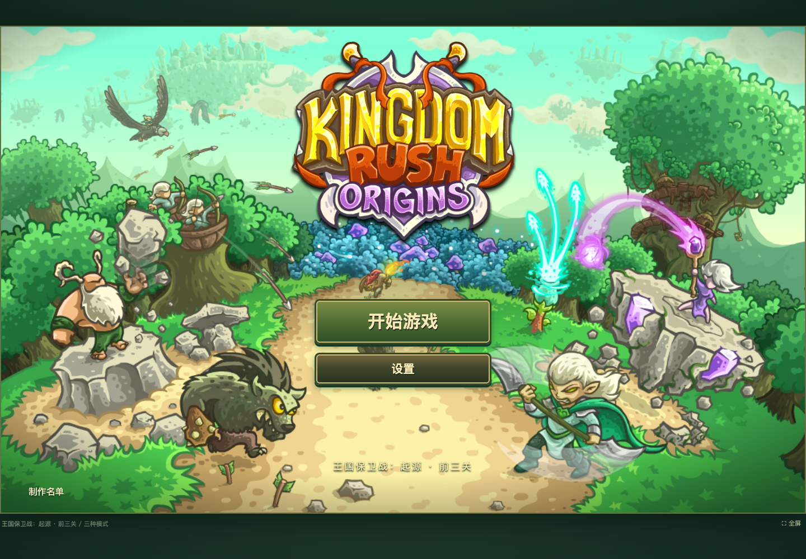
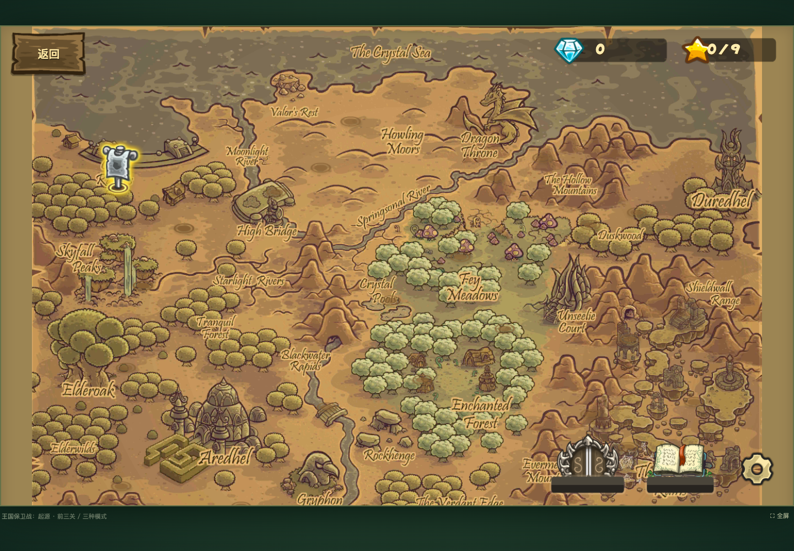

# 王国保卫战：起源 · 浏览器复现

[在线试玩](https://kingdom-rush-origins-first-level.minghaoyusombie.chatgpt.site) · [技术方案](docs/ARCHITECTURE.md) · [参考与差异](docs/REFERENCE.md)

当前版本包含开始界面、三个独立本地存档、大地图，以及**灰鸦港口、高桥、瀑布小径**的战役、英雄挑战和钢铁挑战，共 9 个关卡组合。在线试玩通过 Sites 托管，为私人访问，需要用创建站点的 ChatGPT 账号登录。





## 开始游玩

点击“开始游戏”，选择存档，再点击地图旗帜进入关卡。战役通关解锁下一关；战役获得三星后，解锁该关的英雄与钢铁挑战。后续关卡旗帜仅展示，当前可玩范围为前三关。

- 点击木牌空地建造四类塔；点击已建塔可升级、出售，或调整兵营集结点。不同关卡、模式有各自的禁用塔和等级限制。
- 战役有 20 生命；英雄与钢铁挑战只有 1 生命。英雄挑战为六波精英敌人，钢铁为一波长进攻。
- 技能选择后点击道路施放。1：雷电，2：援军，3：箭雨，H：选择艾瑞丹。空格召唤下一波，Esc 取消选择或暂停。
- 第一关战役会依次解锁技能与英雄；其他关卡按模式规则开放。瀑布小径可点击魔法花发射飞弹。
- 英雄造成伤害积累经验，升级后获得技能点；在地图的英雄殿堂训练箭矢风暴、双重打击或重置技能。其余三项英雄技能暂未开放。
- 暂停菜单可重开、返回地图或切换声音；右上可切换倍速。手机建议横屏，底部可全屏。
- 进度保存在当前浏览器的本地存档中，暂不跨设备同步。声音默认关闭。

## 本地运行

运行不需要 Node 或 npm 依赖：

```sh
python3 -m http.server 8765 --bind 127.0.0.1 --directory web
```

打开 `http://127.0.0.1:8765`，Ctrl+C 停止。ES Modules 和分关卡素材需要通过 HTTP 打开，不要直接双击 `web/index.html`。

## 构建与验证

```sh
npm install
npm test
npm run build
```

`build/` 为可部署的静态目录，附带 SHA-256 文件清单。任意静态服务器均可托管；站点不需要数据库、后端或 API 密钥。

浏览器回归需要先启动上面的本地服务器，然后运行：

```sh
npm run test:browser
```

macOS 默认使用已安装的 Chrome；其他环境可运行 `npx playwright install chromium`，或通过 `CHROME_PATH` 指定 Chrome 可执行文件。可以通过 `TEST_URL` 指向本地构建服务器。截图与回归结果写入 `artifacts/`。

68 项领域、动画与界面数据测试覆盖九种配置、正常预算下的完整通关、失败、禁塔、升级出售、冷却、波次计时、飞行目标、护甲和瀑布路径连接。浏览器测试经过实际界面完成九种模式，并验证三星解锁、存档刷新、暂停和手机横屏操作。完整通关验证使用休闲难度，不代表所有难度都经过平衡验收。

## 素材与数据

来自用户提供的《Kingdom Rush Origins》APK，下载标注版本 5.8.02，大小 277,546,388 字节。原 APK 不包含在仓库内；摘要记录在 `reference/apk-manifest.json`。地图和精灵使用原始素材，ETC1 图像以无损 WebP 保存。

需要重新导出时，将 APK 放在仓库根目录，安装 LuaJIT 与 Python 的 Pillow、texture2ddecoder，再运行：

```sh
python3 tools/extract_campaign.py --apk origins.apk
```

导出脚本不运行游戏流程或 Android 应用，仅读取模板与关卡数据。浏览器中的战斗逻辑、交互和存档是独立实现。

当前仍存在与原版的差异：菜单布局、教学提示、部分战斗移动、英雄技能与音画时序尚未逐帧像素对齐。全局天赋树、成就、后续关卡与 Android 安装包不在本版本范围。原作图像、音乐及角色的权利归 Ironhide Game Studio 等原权利人所有。

动画时序与当前尚未达到 1:1 的部分，见 [保真记录](docs/FIDELITY.md)。

界面回归：启动本地服务器后执行 `npm run test:ui`；原版雷电和箭雨素材检查：`npm run test:effects`。`tools/extract_ui.py` 会从原始布局表和图集中重建界面素材。

## GitHub Pages

`npm run build` 生成可直接部署到 `gh-pages` 分支根目录的静态文件，含 `.nojekyll`。资源与模块均使用相对路径，支持项目路径 `/kingdom-rush/`。仓库首次启用时，在 Settings → Pages 选择 Deploy from a branch、`gh-pages`、`/ (root)`，保存后使用 GitHub 返回的发布地址。SSH 推送权限不能替代 Pages 设置所需的 GitHub 管理/API 登录权限。
