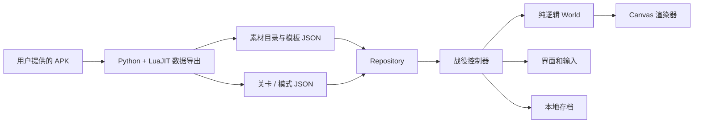

# 技术方案：数据驱动的塔防战役

当前范围是游戏开始界面、大地图，以及前三关的战役、英雄挑战、钢铁挑战，共 9 个组合。运行时只有静态 HTML、CSS、原生 ES Modules 和 Canvas 2D，没有游戏服务器、账号系统或运行时第三方依赖。这样同一份文件既可部署到静态站点，也可在本机通过 HTTP 服务器运行。

## 模块边界



| 模块 | 职责与约束 |
| --- | --- |
| `web/domain.mjs` | 纯战斗模拟、规则校验、模式规则和进度转换。不访问 DOM、Canvas、网络或 localStorage。 |
| `web/repository.mjs` | 加载和缓存关卡、图片，提供三个存档位。存档失败不阻止继续游玩。 |
| `web/renderer.mjs` | 把世界状态映射到画面。使用原始精灵的裁剪、锚点、偏移和动画配置，不改变金币、生命或伤害。 |
| `web/campaign.mjs` | 页面状态、用户输入、选塔菜单、模式选择、音频与胜负处理。通过 World 的方法执行动作。 |
| `tools/extract_campaign.py` | 从 APK 导出素材、模板和九套规则；区分战役、英雄和钢铁各自的实体和预建塔。 |
| `tools/build_site.py` | 复制静态运行文件，产出带 SHA-256 清单的部署目录，避免源文件与线上包不一致。 |

## 状态与数据模型

屏幕状态为 `title → saves → map → loading → battle`。设置、关卡说明和暂停使用独立对话框状态；对话框打开时暂停战斗。胜负结算只在战斗状态变成 `won` 或 `lost` 后触发。进入新关卡创建新的 World，保留存档，不沿用上局敌人、技能冷却或计时器。

关卡标识是 `(stageId, mode)`，不是地图文件名。九个 JSON 各自包含金币、波次、敌人队列、路径、建造点、预建建筑和禁用规则。地图图片由三个模式共享。增加关卡时新增数据与素材，不复制一套战斗循环；增加模式规则时修改模式定义和数据转换，不在界面中绕过规则。

```text
World
  id / mode / difficulty / seed
  status / paused / time
  gold / lives / wave / totalWaves
  routes / slots / plants
  enemies / soldiers / hero / shots / effects
  pending / nextWaveReadyAt / nextWaveAt
  cooldowns / events
```

`build`、`upgrade`、`sell`、`startWave`、`cast`、`setRally` 和 `moveHero` 都验证输入与当前规则。按钮禁用只负责告知用户；真实的金币不足、挑战禁塔、技能冷却检查仍在领域层执行，界面或测试无法靠调用相同动作绕过。

## 时间、路径和战斗

模拟采用固定步长 `1/60` 秒，画面使用 requestAnimationFrame；倍速只增加模拟步数。随机数由可注入的 seed 生成。Node 测试不需要浏览器就能复现战斗。

原始配置的时间单位是 30 FPS 帧数。每一条出怪队列累加自身间隔，缺失的可选 `interval` 按零处理。本组所有出怪结束后，才开始下一组的等待时间；玩家可在下一组准备好后提前召唤。不能从本波开始时就计时，否则后续关卡会出现不符合原版的大量叠波。

每条路线保存节点、累计距离和终点距离。单位沿距离插值移动，不按横坐标判断漏怪，因此向左、向上和向下的出口共用同一套逻辑。瀑布小径的 `3 → 4` 连接显式转移路线，不把飞行单位在中间路径的末端当作漏怪。

伤害分为物理、魔法、范围爆炸和无视护甲。使用原始敌人模板中的护甲与魔抗。飞行标记阻止地面兵营拦截和火炮攻击；二级以上兵营精灵的远程攻击可以命中飞行单位。塔的价格、射程、冷却、投射物伤害与士兵属性均从模板读取。

## 模式与存档

| 关卡 | 战役：金币 / 波数 | 英雄：金币 / 波数 | 钢铁：金币 / 波数 |
| --- | --- | --- | --- |
| 灰鸦港口 | 320 / 6 | 320 / 6 | 460 / 1 |
| 高桥 | 350 / 8 | 480 / 6 | 225 / 1 |
| 瀑布小径 | 400 / 10 | 440 / 6 | 750 / 1 |

战役有 20 生命，挑战只有 1 生命。模式 0 的实体共享，1/2/3 分别对应战役/英雄/钢铁；高桥和瀑布小径的预建兵营必须按模式筛选，不能让其他模式的建造点重叠出现。

战役胜利解锁下一关，获得三星后解锁本关两项挑战。最高星级只增不减；挑战徽章按关卡与模式分别记录。三个存档位互相隔离，保存版本号便于后续迁移。当前存档是本机浏览器存档，跨设备同步需要后续增加独立存储适配器。

## 验证与扩展

领域回归测试覆盖全部九个模式的真实配置、正常预算下的完整通关、失败、禁用塔、升级与出售、冷却、原始缺省字段、护甲、飞行目标和瀑布连接。浏览器回归通过实际按钮进入游戏、选择存档和模式、建塔升级出售、保存后刷新、完成九个模式，并检查手机横屏、HTTP 错误和 JavaScript 异常。

`tests/strategies.mjs` 是回归测试的合法操作脚本，不向产品提供自动通关，不增加金币、不改血量，也不修改原始波次。完整通关回归在休闲难度执行；这证明组合可完成，不代表已经平衡了全部难度。

当前仍是浏览器复现：菜单排版、教学弹窗、音效时序、部分近战移动和英雄技能未做逐帧像素验收；全局天赋树、成就、跨设备存档和后续关卡不在本次实现范围。后续可把技能与关卡机关移到独立效果系统；在已有测试保障下接入新效果，而不把关卡特例继续加进界面控制器。

## 动作时间与表现层契约

每个士兵独立记录 `actionAt`、`walkAt`、`pendingHit`、`departAt` 与死亡计时。战斗层在原始 `hit_time` / `shoot_time` 执行伤害或生成飞弹，渲染层只根据同一动作起点取 30 fps 帧，不能通过播放动画产生伤害。兵营门的五帧打开、0.5 秒保持、四帧关闭，与士兵离营共享 `doorAt`。建造保留原始 `build_duration` 与施工模板。

多人物塔不能共用整个实体的动画状态。`Renderer.entity` 支持每层 `spriteStates`：二、三级弓箭塔的两名射手轮流射击；静态塔身不翻转；投石手的装填层仅在装填阶段显示。动画解析支持原始的 `from/to`、离散 `ranges` 与显式 `frames` 三种格式，单次动作钳制到最后一帧。

验收分两部分：领域测试核对出兵与攻击发生的时间、补员位置、升级保留状态；浏览器生成可查看的动作片段并验证缺失帧。通关通过不能替代画面对照。剩余差异记在 [FIDELITY.md](FIDELITY.md)。

## 原版界面布局的边界

`tools/read_ui.lua` 只提供模板需要的设计期上下文（向量、角度、翻译键），读取数据表；`tools/extract_ui.py` 从原图集裁剪并恢复透明边距，输出 `assets/ui/layouts.json` 和原版精灵。`Repository` 一并加载它们。

`web/ui.mjs` 将原始位置、锚点和尺寸换成容器百分比，支持普通/按下状态与对称九宫格。Campaign 将真实存档、模式锁定和战斗结果绑定到这些控件。界面适配不会改变游戏状态；领域层也不依赖参考屏幕的尺寸。

布局表来自 693×320 的原始手机界面坐标。宿主视口适配、中文字体回退、转场和未实现的原版控件必须独立列为差异，不能因复用了原素材就宣称全界面像素一致。

## 技能事件时间线

`web/spells.mjs` 的 `SpellTimeline` 只读取世界模拟时间：控制器事件按 `(at, sequence)` 排序，雷电在每个事件发生时重新选敌，箭雨独立记录每支箭的出发位置、目标节点、速度和抵达时间。`World` 在固定步长中推进它，命中会产生真实伤害、减速与渲染事件；Renderer 只绘制同一组飞行对象和落地事件。没有浏览器定时器，也没有与伤害脱离的装饰性假箭雨。

技能等级与英雄角色等级分别建模。当前没有开放技能训练时，艾瑞丹箭雨采用原始零级值；读角色等级不能自动把技能升级。`history` 保留最近 512 次实际命中，用于定位时序问题，不进入存档。通关策略只使用正常金币、技能冷却与操作，独立于战斗实现。

## 方向与操作动画

`Renderer.enemyDirection` 根据路径切向量选择原始侧面/上/下帧，侧面默认朝右；WeakMap 保存转向保持状态，避免将表示状态写进 World。方向回归直接截取 Renderer 实际选择的精灵与镜像参数，覆盖九模式路径，补上通关测试无法发现的视觉错误。

建塔菜单的 120ms 缩放/透明度由同一 Web Animation 驱动，取消旧动画后再重开，收起完成后才清空节点；收起期间使用 inert 阻止过期操作。界面时钟不影响战斗时钟。

## 英雄与交战状态

英雄独立保存 `stance`、`action/actionAt`、`walkAt`、`flip`、`pendingHit` 和 `combatTarget`。移动、弓剑切换、起手、实际伤害和死亡复活都使用 World 模拟时间；Renderer 读取这些状态选择原帧。移动命令会取消尚未执行的出箭/挥剑事件，不删除已经飞出的箭。交战期间的拦截与攻击冷却独立于动作播放，避免武器切换时敌人穿过英雄。

敌人的 `actionFlip` 来自真实守军位置，独立于沿路行走方向；`enemyMelee` 每个模拟时刻最多推进一次攻击，英雄与兵营不能重复扣减同一敌人的冷却。经验、训练和天赋仍不在这些表示状态中，后续应单独建模。
