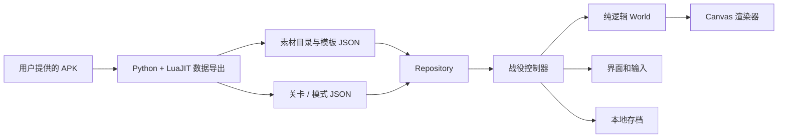

# 技术方案：数据驱动的塔防战役


## 0.2.144：第7关 faerie 暂存运输（隔离验证）

`web/stages/faerie.mjs`接原18716–18858/18864–18920的基础连续流程。按原FAERIE1024格与每条道路第一lane编译半开区段，原第4路[35,70)、第5路[77,110)，索引保留一基；实际数据无开放尾部，不凭猜测填源global ni。path_speeds数字0/1保留，默认yellow30、显式red75。独立nav移动，不覆盖敌人speed；移出战斗集合、释放当前减速/中毒/睡眠/ward所属效果、解除当前blocker，保留原对象/HP/gold/id。limbo保持Hoplite组计数，重插不重加；恢复原对象后重启已接controller时钟。已发普通hurt持有引用时仅第7拒绝limbo伤害，不给旧六关增加state/RNG。

原两层同色nav（静态球+原动画）与入/出smoke、大小比例/anchor/z/tween纯绘制；原粒子发射器、完整通用mod/aura移除、native insert/remove队列与IDs、stun_force全部状态、所有敌人重插协程和动态路径仍为适配或待补，非原版同输入1:1。当前释放自己拥有的睡眠计数，保留外部stunned/其他计数；并非通用清空眩晕。source新增nav/fx/粒子声明闭包，4679逻辑帧/6,369,762B无损，未清alpha0RGB/整atlas；旧4/5/6图与1314frame compact保持。第7入口仍closed、正式前六关18模式，自己的预算和其余必要机制仍欠。

0.2.143第7隔离重装羊人已接原施法/三次召唤/零金币羊人入场与共享并发计数组、尸体释放和实际子兵双刀。正式仍前六关18模式，第7closed；详STAGES-7-10，不冒天然通关或完整1:1。

0.2.142第7隔离羊人双刀已接三段动画/两次queue飞刀/原抛物线与命中伤害，生产仍前六关18模式，第7closed。详见STAGES-7-10，不冒自然通关或21模式。

0.2.141开始第7关“石环阵”隔离还原：原毒南瓜25秒准备、点击空放也消耗、17帧范围释放、4秒减速与毒抗DOT/恢复、原烟雾/贴图和手机触摸已接通。611Node与实际Canvas专项通过，前六关18模式保持。新第7冷入口16,852,393B明确超15MB且专有新敌/faerie_trails/Druid/自然模式等未全，入口仍关闭。详见 `docs/STAGES-7-10.md`；不把隔离机制或原图导入称新三模式/全像素完成。


0.2.140正式发布第6关「狮鹫驿站」三模式，生产cap6/前六关18模式。原flag6(609,814)、9道路点与stage_thumbs_0006原342×246书页来自固定map_points/desktop atlas声明，RGBA裁图无损；原第一波TOWER_MAGE_WILD_MAGUS通知与狂野魔术师百科接通。旧第五胜利save只迁移访问6，不赠XP、星或挑战；原道路旗揭示一次后保存。真实胜利再记第6星/挑战，手机重载保留。第7关仍拒绝。不是整关/全系统1:1像素认证。

百科专用声明改为实际统计字段投影，逐塔/敌与原完整模板统计对比一致；战斗仍由ExpansionRepository按关完整模板原子替换/解码，不删战斗图或弱化机制。此举修复发布初包把第五冷入口推到15,021,175B的失败，不抬预算或降质。原compact1314帧2122316B和所有战斗图字节不变。

浏览器真实第五已赚checkpoint XP38903起，合法训练/天赋后按World API连续战役18命三星、英雄120/120、铁人169/169，首领death-complete/父complete、原通知发现、奖励存档和手机重载通过，末XP48653。测试以固定步长驱动World，批次间真实等待第14波boss/cart网络decode；控制测试宿主RAF避免同一World被两个时钟推进，不写HP/gold/伤害/seed/cd或assetsReady。不是原版同输入同步。初较弱策略13/17命和一版iron lost保留，最终仅合法策略emergencyRange campaign350/iron220；默认CPU旧计划保持。CPU新档1–4→5→6自然链仍20命零漏/heroic120/iron169，末XP47121且真实recordVictory记奖励。人类援军叠音.132修复保留。


最终验收：601项Node测试全过；原完整天然九模式/存档手机、连续新档4/5/6 CPU自然链、stage6-browser-final完整三胜奖励/手机重载、stage6-presentation一次迁移/原书页与UI通过。另一publish浏览器也已写完三胜/手机结果，但Node在关闭阶段挂住，确认无子进程并比daemon88207后精确TERM收143，不称exit0；其后独立弱策略iron失败保留，不把策略搜索失败改产品值。最终重试流程允许真实点击“再战一次”，只沿产品事件保存实际earned XP，不伪造存档/奖励。

最终actualbuild1666files/96,300,852B含manifest；web模块全逐字节一致，原第6缩略图RGBA exact。cold100ms/1.5MBps/cacheoff：旧14,852,300B/240req，总16.096s；第四真实旗书14,809,678B/230req，book7.172s/总16.991s；第五14,992,983B/241req，book7.852s/总17.722s；第六真实旗书14,933,653B/240req，book8.134s/总23.728s，15MB全exit0。第6总时长含旧存档首次道路旗揭示；不保所有线路。第五仅7017B余量。boss/cart事件仍另实际下载3.87MB，不称整局总流量15MB。公开本轮一次manifest确认.139/UI exit0，新推送不轮询CI。

主要logs artifacts/sixth-tests-publish/build-publish/browser-final/browser-publish/browser-publish-repeat/browser-retry-flow/presentation/natural-final/old-nine-build/ui/pages-ui/performance-publish/stage4-performance-publish/stage5-performance-publish/stage6-performance-publish.log；sixth-browser-publish是关闭阶段143，repeat是弱iron策略失败。完整正常browser-final保存了真实三模式/奖励/手机结果；不同输入/初始时钟下自动策略不保证零漏。当前普通15波后必须实际囚车/首领/死亡收尾，最终父complete才won，没去掉机制来过自然样本。

补充最终交付记录：sixth-browser-retry-flow的独立自动计划iron多次lost保留，未修改产品数值；artifacts/stage6-iron-continuation.mjs首脚本生成误把prep的step替换成含t的片段，ReferenceError为fixture。修正后，从真实已赚第6heroic存档续铁人、真实20秒准备与原“再战一次”后169/169 won，奖励/手机重载/清理全部正常exit0（sixth-iron-continuation-repeat.log）。这是合法续测，不拿末XP51088冒首次入6前置，也不冒称所有自动策略首试必过。首次完整三模式正常browser-final，以及publish三胜/持久化后关闭143的记录保持区分。最终main/runtime cbdee0f，Pages f1af29b，私有source1d71efa75e3f588b072b6d0fedc2a2e444ca0d6d/deploy appgdep_6aee25be2758819189ea501bae73bf1e succeeded，owner-only。

0.2.139实际闭合狂野魔术师「破坏守卫」ward三级购买/施法/沉默与恢复链。原每档225/max3/目标数1、3、6，10秒strict冷却、14/30施法；第一档changed被outerloop观察才起cd，后两档不重置，首观察前连升保留原ts0。source F_SPELLCASTER2147483648且can_do_magic、原范围/vis门选最前排序列表；cast开始捕获列表，释放时不擅加新range/vis/magic门，取当时等级上限queue mod，释放后再记冷却ts。已开始phase不因tower.blocked中途冻结。s.wild.powers独立，塔810+技能675=spent1485/战斗退891；eldritch与普通交替手/same计数保持。

原mod_ward经game_scripts共享scripts表继承mod_silence.insert/remove（4889–4921）与mod_track_target.update（4263–4300），APK没有KR3 override；controllers仅-bl不执行。insert只有实体/health alive/enemy门，原can_do_magic/can_accept_magic直接false，remove对仍在entities的enemy直接true，不虚构引用计数或保存prior false；未改外部stunned/frozen、Arcane/Blade stun计数。同级重复仅刷新modifier.ts、不重置tween年龄；低级拒绝，高级替换；strict now-ts>10或死亡/移除后释放自己状态。不同外部沉默的完整通用组合生命周期仍不是已实现的通用引擎，不能声称全部原mod都闭合。

真实职责接到既有blighter封花新episode与harasser.requires_magic闪避门；原已有普通近战/箭仍正常。重要源细节：blighter能量attack声明requires_magic=true，但仅SU2693–2756新目标获取检查magic；已进入的ranged episode在can_range_soldier2309–2325与range_attacks2937–3131不再检查magic，直到目标失效/episode退出。所以本批没有凭直觉取消已开能量或给持有目标加新全局门；新增纯测确认已提交弹与连续episode照原继续，新获取被阻。已进入封花cast按原y_wait只被death/stun等打断，沉默不回滚已提交动作。完整原game_scripts8647–8723与SU138–157也只读审计。

原ward.bans四项中本关真实存在mod_gnoll_boss：插入后撤原HPbonus/factor并禁止pending/后续重入，过期允许原aura继续，不假阻gnawer等不在列表的增益。其他更后关卡尚无runtime的heal/consume/shadow_champion仅声明不冒已实现。本批未修改旧五关RNG/伤害/HP/施法clock；只有实际ward插入才有canDoMagic/canAcceptMagic/World.wildWards新状态。

原塔sprite5/6按source独立alpha keys（2/30→16/30淡入、25/30保持→1秒淡完），rune7原25frame后隐藏、body wardUp/Down32frame；纯draw按Worldclock，offset tween/anchor/z原样，overlay不假跟shooter.flip。目标头标原custom_offsets（blighter y39）、不再叠unit.mod_offset；两地贴z1400，其中原scale1/.4是真双轴，不套Renderer.entity旧等比scale。三mod sprite独立原0/.25/9.75/10 alpha keys并跟目标移动，same-rank刷新不重开显示年龄。真实pause冻结，卖塔不清除已经插入的modifier，丢World/换场景无timer/cache回填。

0.2.138实际闭合狂野魔术师eldritch三档购买/射线/吞噬/延时魔法AOE基础连续链。原325/185/185、max3，累计spent1505（塔810+技能695）、战斗退款903；仅s.wild.powers独立状态，ward仍disabled与World拒买。第一档changed被controller观察才起28秒strict冷却，后两档24/20秒不重置起点，首观察前直升2档保留模板ts0。原20/30射线释放、34frame施法，开始后不被tower.blocked中途冻，释放重新核health/vis/1.1椭圆，失效则按原范围重找最前目标；不改普通双手same计数或抽新chance随机。

原game_templates注册ray_wild_magus读取game_scripts.ray_simple，但APK game_scripts实际上require并返回共享scripts表且无ray_simple override，故继承all/scripts3242–3353及3248闭包，不是精灵force_motion。射线2/30后queue mod、没有普通直接伤害；追踪Chebyshev上限64相对insert时原bullet.to（非逐tick累积重置），F_RANGED或超距粘性失追，仍原hitFX但不插mod。射线原16frame/anchor0,.5/z3400，x轴距离/image_width144而y轴保持1，专用Canvas双轴矩阵，不把Renderer.entity旧等比scale当源射线正确；原hitFX/z3300。

mod下一Worldtick插入，只活/实体存在/源modifier flags门成功；同级不重复启动，高级替换低级，低级拒绝。再下一Worldtick按原systems.health DAMAGE_EAT4096令HP0，检查原health.ignore_damage/immune_to，真实一次原金币/无主英雄假XP，carrier继承原EAT禁落兵/隐藏死亡，不用超大普通伤害冒吞噬。原敌闲置render快照按eldritch_enemy_decal 0..20/30抖动scale tween膨胀，隐藏正常尸体；mod原12frame loop跟初始mod_offset，等待20/30结束后原19frame爆炸。AOE在固定初始mod.pos、87.5/.7椭圆按源flags筛活敌，下一tick80/180/260固定magic4，不乘塔damage_factor、不抽伤害随机。爆炸画面在原target引用当前pos+unit.mod_offset，和AOE中心职责不混淆。完整native modifier ban列表/queueIDs/协程同tick、敌render运行时多层快照、额外blood/pop/水格/声音尚适配或欠，不能说全部技能FX/全塔1:1。

0.2.137实际闭合第6狂野魔术师基础升级/攻击链，不再把原未锁列表当作已实现。保留四基础TYPES，运行时mage level4映射原tower_wild_magus（原模板tower.level1不改）；仅第6允许且按mode原locked_towers再验，第4/5仍锁。真实mage1→2→3→wild价格100/160/250/300，累计810，准备期全退、战斗退款486；action_arg拒high_elven假升。原wild菜单两项eldritch/ward尚未实现，保持disabled、World拒付，不给s.arcane冒身份。原info肖像portraits_towers_0007直接PNG exact裁图，UI624图，InfoBar与tooltip按魔法塔/8–16/范围180原数据，当前已实现的crystal_focus/bane_spell按原upgrades TDUP73/75明确包含该塔/弹体，分别ceil范围*1.05与原伤害*1.15；模板只读。

web/wild-magus.mjs独立状态，原strict>.3秒cd/4帧释放，先右手再左手、8帧施法动画，source release只重验1.1倍椭圆，不凭感觉加健康/vis门。target对象相同的连续成功释放递增same，非命中计数：floor(base+min(24,.5*same))，前两发仍8–16、第三发9–17，最大32–40；换对象清零。原手/朝向弹口、shooter offset tween后再加y30判朝向，idle按原目标复算、长闲3秒朝右下。普通攻击本身不抽chance1随机。已开始phase不被tower.blocked中途冻结，新episode被禁。

重要继承链经安全stub-tag reader实际核实：bolt_wild_magus继承scripts.bolt.insert/update（原all/scripts2921–3074），不是game_scripts.bolt_elves！generic insert只查实体/F_RANGED，不凭感觉拒死目标。按原FPS30*ceil(mspeed/30*.25)每当前模拟tick增长、30..2100夹值，while旧距离>旧speed*dt才跟踪并移动，Chebyshev位移strict>128或F_RANGED后粘性失追，失追/死亡仍飞到to并有FX、不虚构HP损伤。结束准确snap到to，仍合法活目标才ceil(frandom8..16*factor)经原魔法伤害链，没火DOT/额外dodge。rotation指向移动后的to，不套箭抛物线/精灵force_motion公式；alpha按原4/30从0到255。当前World队列/实体身份/协程tick与queued damage仍适配，非同输入native逐帧全复刻。

source 17sprite中的地形/两塔层/射手/10浮石与隐藏技能层保持原anchor/z/sort_y_offset；offset tween按原各自ts/2秒loop纯采样，只绘制不写World/RNG。renderer进同actorqueue，projectile用原flying动画/anchor/alpha/角度，hitFX在to/z3300。完整粒子尾迹/pop/blood/audio/高级global talent empowerment-alter_reality和通用modifier/native ID生命周期仍未全，不能称全塔或第6完成。当前高阶全局天赋本来未列TRAINABLE，不新增假购买/假传送。

extract_wild_magus.py只读-bl审计原game_scripts520–697/all scripts2921–3074/utils245–332与升级proto；read_wild_functions.lua用原templates声明+脚本stub记录真实函数路径，不执行controllers；read_wild_magus_rules.lua只loadfile/jit.util.funck取原升级TDUP，不调用chunk或patch函数。9源码SHA与原PNG SHA固定并重提拒变，368帧672348B独立wild-magus组RGBA/size/trim全校验，仅level6取metadata、三级法师升级菜单显示/交易前才decode该组，source controllers永不运行。优化器排除独立wild运行模块的绘制字面量，旧compact仍1314帧2122316B；stage04/05/06仍1925/1815/2204帧与4090840/3175904/4109998B（仅runtime审计SHA更新），没把高级塔整图塞旧cold。完整extract_campaign/build接新工具与gzip。

581Node全过（7新wild）。actualbuild wild-browser-final真实菜单支付100/160/250，初600剩90；3个原ettin真实死亡收益各70后才付300升级，最终0gold/spent810，未直接写gold。真实点击清焦点后Space开wave1，受控原路径节点ettin/时钟隔离，经World.step自动右/左施法、同目标same>=4与实际魔法伤HP（hit14/14/15/11/13，原ettin随后回血，不用末HP当累计伤害）；source Canvas原q/alpha.125/旋转矩阵/位置、13个wild包塔层+1弹体（地形另用原common）/无missing-unready，draw完整World快照不变，真pause/zoom/844x390 CDP touch/map清理unlocked1通过。cast/purchased/mobile图人工看，受控fixture非天然第6/原版同输入pixelcert；塔菜单与旧InfoBar安全区/原全GUI仍非完全同步，不拿截图冒全UI像素验收。

初pure误把4/30精确浮点采样当必到释放，改下一原frame采样；误认crystal_focus为1.2，核原声明实际1.05后改fixture，不改产品阈值/数值。首browser误计15个wild包图，实际地形在旧common所以14，已按源分组纠正；第二次Space被旧菜单按钮focus正确门挡住，改真实canvas点空白释放focus再Space并断言wave1，没有移除产品输入门。最后补InfoBar魔法类型与等原.4秒展开后截图，重新581纯测/build和专项/UI/四预算全过。wild-browser-first/repeat失败保留，wave/final成功。

第6仍closed，生产前五关15模式。尚欠此塔eldritch/ward技能购买/施法分支、原全音效粒子/native modifier等与真正第6浏览器自然奖励链/flag6路book6通知/savecap6/手机重载，不能以基础塔接通称18完成。下一批应实际推进原eldritch或ward完整必要流程，再集中第6真实发布验收，勿无限磨普通bolt/悬浮/旧HUD/已完boss与资源包。

最终actualbuild1661文件96174185B（含manifest），全部web运行模块/新wild图组与build逐字节相同，pin重提成功。原天然完整九模式/存档手机wild-old-nine、连续新档1–4→5 wild-natural4/natural5（4campaign19命三星/heroic142/iron95；5campaign20命/heroic201/iron147/XP37600）、stage6 assets事务回归、UI与公开.136 UI正常exit0。末次InfoBar仅wild类型修正后重新纯测/build，wild-browser-final/ui-final及四冷路径全部正常exit0，无产品/browser挂住待收。

最终cold100ms/1.5MBps/cacheoff旧14839326B/238req book7.166s总16.969s；第4真实旗书14796699B/228req book7.213总17.128；第5真实旗书14980006B/239req book7.895总17.809；第6隔离14843692B/232req book6.793总16.929，15MB都过、不保所有线路。第五余19994B，未来技能大数据只level6按需，不能全局raw导入挤爆旧五。第6不是发布的flag6/book6路径，全事件阶段仍需额外3.87MB boss/cart实际decode，不能冒整局传输<15MB。主要logs artifacts/wild-source-pinned/tests-final/build-final/browser-final/assets-regression/old-nine/natural4/natural5/ui-final/performance-final/stage4-performance-final/stage5-performance-final/stage6-performance-final/pages-ui.log。

0.2.136实际解决第6隔离冷入口预算：stage06共享帧改按实际render.sprites与已审计runtime模板闭包选取（含fixed Alleria/gryphon/guards），2204帧4,109,998B，所有保留帧RGBA/size/trim逐一验证；旧stage04/05图片字节与旧1314帧2,122,316B塔compact不变。boss/cart完整原图与元数据均保留，但campaignEnemySheets不再在开场预载两张结局sheet；campaignEventSheets只在campaign6声明，heroic/iron不取boss/cart包。第14波（最后一波之前）真实开始异步预解码，两个完整sheet都decode后才能标ready。不是删除必需图或假load，也不在原事件生成之后补图。

新Stage6EventAssets绑定World/scene/version，失败不吞错：提供真实重试按钮。若最后普通波清空时仍未ready，stage6AssetsWaiting禁止World.step前进及交易，原父controller仍留waves，结局/金币/HP/RNG/时钟不变化；用户重试成功才恢复原2秒等待/囚车/首领链。第14波预加载时正常战斗不停，HTTP等待不消费World RNG；已解码图可复用现Renderer只读cache，但旧owner/销毁/换版本的迟到Promise不得设置World ready或重建UI。没有后台timer或跨World结局状态。

574 Node全过（3新资产事务纯测）。actualbuild event-assets-browser故意abort真实boss图片，验证最终事件与Worldclock禁止提前启动；844x390 CDP真触摸重试成功，真实cart/boss sheet全decode后parent到fight，Canvas无missing/unready；独立fresh page hold请求→退地图→放行验证旧World不回填ready、UI不复活。完整ending-browser在受控最后波fixture中由父controller排队首领→真实召唤→死亡→won，含源Canvas矩阵/暂停手机清理；aura/guards、三关场景专项、原天然完整九模式/存档手机与UI回归通过。三场景老fixture仍断言base四关，发现现已发布五关后只修期望5，产品cap未改。

新增tests/stage6-strategy.mjs/stage6-natural.mjs可复现合法自然测试：先原tests/stage4-natural→stage5-natural从新档真正赚XP37600/星，再用trainHeroSkill/buyUpgrade真实预算。第6campaign20命/0漏/764kill772spawn（首领死亡原无奖励清场8个）且boss death-complete/父complete；以实际战斗XP43810续heroic120/120零漏→XP45926续iron169/169零漏→末XP47121。只有隔离World之间续实际已赚战斗XP，不写World金币/HP/伤害/冷却/seed/路径终点，也不伪造星/解锁；recordVictory(6)被当前cap5正确拒绝。结果battleReady=true/releaseReady=false，是当前模拟的自然三模式，不是实际发布浏览器奖励链或原版同输入像素验收。

早期合法方案campaign10/7命、heroic过、iron失败保留在ignored artifacts。iron初计划错误尝试锁住的archer/barrack，后用允许的mage/rock；低级平铺仍漏burner，诊断源当前防守终点约574,475而非道路最后559,583，没改产品终点或敌人值。最终先合法mage6三级/mage10一级、英雄道路点450附近，再按计划升级通过；不要把错建造类/站位当产品bug。实际原rules第6campaign/heroic不锁tower_wild_magus，当前尚未实现此高级法师塔，是新确认发布缺口；不是基础mage3或Arcane替身可以冒全源能力已齐。

最终cold100ms/1.5MBps/cacheoff旧14833279B/237req book7.234s总17.049s；第四真实旗书14790652B/227req book7.182总17.039；第五真实旗书14973959B/238req book7.859总17.647；第六隔离真实title/save/map/book入口14831551B/230req book6.641总16.707，15MB全部正常exit0。不抬预算/降质/清透明RGB/漏当前必需帧，不保所有线上线路；第6完整事件阶段还会实际下载约3.87MB原图，不能把冷入口<15MB写成全局整局传输<15MB。第五只余26041B，未来大模块/图必须按本关依赖。

生产仍前五关15模式，第6closed：必须先补原允许wild magus必要升级/战斗功能，之后完整浏览器自然三模式/源旗路书页通知奖励cap6与实际发布冷路径/手机重载都验收，再称18模式。初隔离预算通过不等于真实flag6/book6入口已过。全量提取/分组/build可重建，运行模块逐字节等实际build；本轮最终包1655文件95434801B含manifest。主要logs artifacts/event-assets-tests/build/groups-final/browser/ending/guards/aura/scenes-repeat/old-nine/ui/natural4/natural5/natural6/performance/stage4-performance/stage5-performance/stage6-performance/pages-ui.log；首scenes.log是旧fixture失败，repeat已正常。

末次补充等待/失败界面的真实“返回地图”按钮，避免网络故障只能重试；独立hold请求后实际点击该按钮、放行请求，确认旧owner不回填。574纯测重新全过，最终build1655文件95435058B；event-assets-browser-final、stage5-performance-final和stage6-performance-final全部正常exit0，最终第五14974216B/238req（book7.881s总17.751s），第六14831808B/230req（book6.690s总16.879s），第五余25784B。旧九/第4/旧预算为按钮补充前同模拟包通过，最后仅第6网络等待UI变更，无战斗/源帧/RNG修改。最终所有web模块与build逐字节一致。

0.2.135实际接通campaign第6父level06结局：最后普通波次真正结束且无活敌后等2秒，源遮幕/2秒镜头/隐藏GUI，囚车从visible.left−132、y459以47速行至120,459；到位仍yield一次、下一tick才open；open动画83/30后按原nearest_nodes默认lane1取最近节点+1，下一模拟tick生成真实eb_gnoll并连接现megaSpawner。3/30后只前五sprite降Z_DECALS1400，第六保留3000/sort_y_offset−10。父状态读取实际gnollBoss.phase，只有进入loop才恢复镜头/GUI；等待dead→death-complete后再1秒且wavesfinished无活敌才放行原胜利门。普通15波清空不再是假won或永远无条件拦截。heroic/iron原结束链不加囚车。

stage6-ending.mjs只改该World的状态，Stage6EndingView纯读Worldclock驱动原黑幕out-cubic与镜头in-out-quad；源相机目标(120,500)/zoom2→(512,384)/zoom1，使用现BattleCamera边界适配，不称原native camera完全同步。隐藏GUI期间真实交易/英雄移动/施法/鼠标镜头/键盘入口禁止，模拟继续；暂停则Worldclock/车/镜头停止，返回地图销毁遮幕/inert与owner。原协程yield/原动态nav-grid/native队列ID、音频、全死亡与屏幕震动仍欠或适配，不称完整1:1。

原六层walk1..22、open23..181共1086逻辑帧，101唯一裁片/1,299,296B独立stage6-ending图组，原PNG/quad/size/trim/RGBA逐帧无损校验；只campaign6按需读取声明并完整decode，旧五关不下载车图。当前第6入口仍全量decode boss+cart，预算明确尚未完成；不以将来事件用图假延后/抬15MB/降质冒过关。extract_stage6_ending.py固定7原源码SHA和原图SHA，helper只loadfile+jit.util.funck读取level06相机TDUP与声明constants，控制器仅-bl审计、不执行。完整extract_campaign/build可重建。

实际build ending-browser-repeat从真实Space开波后受控清到最后波，父controller自行驶入/开笼/排队真实首领→吼叫触发真实召唤→恢复GUI→真实hurt击杀→death-complete→最终won，Canvas六原图/alpha/无missing或未decode/draw完整World快照不变、真pause/zoom/844x390 CDP触摸/地图清理通过。截图人工看过；这是受控最终波样本，不是自然第6通关或同输入pixelcert。首浏览器发现新view将guiReference直接传给需reference包装的视口函数，实修并重建后完整通过，失败日志保留。571 Node全过（5新结局）。生产仍前五关15模式，第6继续关闭，天然三模式、自身15MB、原旗路书页/通知/奖励cap6尚未验收，不称18模式完成。

0.2.134 gnoll-aura.mjs接原aura_apply_mod→mod_gnoll_boss生命周期，只实际第6目标创建状态；排队插入/同级刷新/严格过期/原HPbonus与ceil系数撤回，普通近战与infobar读unit系数，普通箭仍读bullet系数。原三静态图/环alpha-scale独立loop进actorqueue，纯绘制不写World。boss包234帧2,571,592B只第6按需，controllers只-bl。囚车/相机/结局及native队列/全modifier仍欠，第6继续关闭。

0.2.133首领基础控制器gnoll-boss.mjs只在id6/eb_gnoll实例创建状态，读取level6按需原模板，开场/节点howl真实连接现megaSpawner。近战与stomp独立phase，绘制gnollBossPose纯读，100秒死亡保留覆盖普通敌1.2秒清理；源码仍只-bl审计。source physical|NO_DODGE在boss caller开启mask护甲分支，其他hurtDefender调用维持旧规则。原boss aura/mod、囚车/相机/最终父controller及native队列/IDs/全音频仍未完成，第6不开放，不能称18模式或同输入1:1。

0.2.132独立MeleeAudio接Campaign.sound(melee)，只管理一个原SWORDS声道、五短clip的sequence与450ms忽略窗；effectAudio共同管理音量，pause/modal/静音/transition清理并取消旧媒体播放，无队列/timer/World引用或RNG。原先每击播放8秒barracks fight导致援军死亡后仍多轨叠音。其他原sound_db组/全单位专属音效仍未完整恢复。

0.2.131第6独立World.megaSpawner持有按需data/manualWave/current/queue/insertQueue。完整原level06四组路径声明由ExpansionRepository仅level6读取，控制器模块无大静态数据。队列编译先分配point再抽lane/interval/variation，到期提交下一tick真实spawn；同manual名称不重放、换名yield与interrupt职责独立。原source分支无CUSTOM/PACK，未扩虚假通用API。campaign6胜利显式阻止普通波次完成误判；首领caller/囚车/最终收尾尚未连接，不开入口。第五及旧World不创建本集合或消费新随机。

当前范围是游戏开始界面、大地图，以及前五关的战役、英雄挑战、钢铁挑战，共 15 个组合。运行时只有静态 HTML、CSS、原生 ES Modules 和 Canvas 2D，没有游戏服务器、账号系统或运行时第三方依赖。这样同一份文件既可部署到静态站点，也可在本机通过 HTTP 服务器运行。

## 模块边界

0.2.130固定Alleria使用独立World.fixedAlleria，仅第6创建；不进入stageHeroes/多英雄GUI/普通援军和敌方target枚举。共用Alleria箭的发射/已审计抛物线适配，不共用第五可选英雄的近战、移动、成长和死亡控制器；固定猫仍归同World队列且继承父z，直接固定位置，不求第五网格rally。Renderer只读独立NPC/cat pose。第6catalog按需合并fixed声明与已有Alleria图包，旧五关图包/World随机流不增加新类状态。公开范围仍cap5，第6boss/spawner链和15MB预算未过。

0.2.129发布cap5统一来自campaign-release.mjs。生成器从原4/5声明构建mode索引与书用模板统计；Repository.init合并书用原声明，level仍按需加载战斗资源。历史第四胜利只迁移访问权，沿一次原地图揭示后保存，不赠星/XP；真实第五胜利与挑战分别recordVictory，cap5不开放未完成首领链的第6关。源首波高级塔通知仅在已有真实layout时接收，沿原seen标记启用百科；不在World里写UI存档或额外随机。

0.2.128第5/6隔离catalog使用tower-groups/entry变体：common先decode，预建实体按真实template依赖补齐，空地菜单由towerMenuSheets返回当前allowed一级族的完整依赖，prepareTowerMenu在decode和owner/scene/slot/version检查完成前保持hidden/inert。第4沿用旧tier组，旧1–3沿用原compact。第五场景共享图闭包读取实际render.sprites而不是任意组件字符串，并记录runtime模块SHA；metadata存在不等于图片就绪，实际Canvas专项同时验证sheet已decode。此调整不触及World时钟/交易数值/随机流或save cap4。

`ProjectileMotion`仅为当前rock_1/2的body持有WeakMap展示选择：原bomb.insert初始(random-.5)*pi与发射方向signed rotation_speed，在首次观察时固定，之后按elapsed派生旋转、同帧重画不重抽；loadLevel/transition reset。独立UI RNG不读写World seed/serial/飞行数组，不能声称Love同seed随机轨迹。普通箭仍使用现有chord朝向，原per-tick last_pos/抛物线/目标预测尚未恢复，不用渲染帧间差分冒充模拟速度。


`constructionBarPose`只从当前tower_build模板第4sprite与scale tween派生进度条姿态，drawConstructionBar在原World/camera队列内执行独立x/y缩放。完整54×8原图、offset(-21,50)、anchor(0,.5)、alpha255与z3000保留，不再用固定屏幕clip猜测宽高。当前普通击杀的World coin事件仍保留，但Renderer不绘制自创的黄色金币浮字；原GUI got-enemy-gold只在Hand of Midas生效时创建奖励特效，该特殊能力尚未实现，原金币实值与独立早波WaveReward不变。


`TowerEffects`只读观察现有build/sell展示事件，以原fx_tower_buy_dust/fx_tower_sell_dust声明生成12帧、3300层、半图锚点的烟尘。初次购买按当前World.buildUntil延迟，纯展示缓存跨过原World事件.7秒寿命，升级立即、卖塔原位置+35；不改World事件/交易/退款/计时或RNG。pending购买随原塔取消，已发出的烟尘独立；owner/loadLevel/transition清缓存。原建造协程严格大于build_duration才升级的量化时刻与World现有完成条件仍有差异，不声称同输入逐帧一致。


`NativeUI.image`以原KView左上原点执行scale→rotate(-r)→translate(-anchor)，不再使用CSS默认中心缩放。通知父组同样保留原位置、先缩放/负旋转再锚点位移，照片和子边框共享同一坐标链。带锚点的平移以原图面尺寸换算，不用看图补偏移；generic helper覆盖通知外其他NativeUI图片，测试以实际DOM内容四角比对原层级矩阵。

`SkillEffects`从只读原模板/tween声明派生雷电射线、镜像爆炸、地面贴花与箭雨地面箭/烟雾逐sprite姿态并入actor队列。定时组件按原帧数结束，alpha按原keys线性取样，射线独立y拉伸；一次展示随机翻转/落箭角度由WeakMap与独立UI RNG持有，重画不重抽、场景reset，不改World seed或实际施法时钟。range及尚未恢复的环境特效等仍独立，原全局ID与同输入随机轨迹未恢复。

`GroundCorpses`拥有当前四种地面敌普通死亡的只读展示快照；不透明死亡动画与末帧按原health.dead_lifetime保留到严格大于2秒。World仍在1.2秒清理模拟数组，缓存不进入碰撞/寻敌/伤害/奖励或随机迭代。快照只留绘制必要字段，以原World时间驱动；复活/漏怪清条目，场景owner变化、loadLevel提交和Campaign.transition都reset，旧尸体不跨槽/场景复活。特殊伤害/地形死亡、血池及原尸体点击仍未建模，不称完整敌死亡状态恢复。

`projectileSprites`按原arrow/bomb职责仅对首sprite应用发射点/目标点严格半径隐藏，边界等于半径可见，距离以既有World坐标测量、不乘图集缩放；火把按源左右投掷方向选择signed rotation_speed与flip，读原sprite.r和elapsed，不修改World.rotationSpeed。当前飞行路径与普通箭chord方向仍未恢复；炮石原旋转规则由独立ProjectileMotion接入，原随机seed轨迹未恢复。

`projectileSprites`将本局bullet模板的逐sprite元数据映射到既有World飞行位置与elapsed，不改弹道模拟；魔法弹body与shadow有独立z/offset/scale，普通箭/炮石/英雄箭/火把与已有地图前景在actor队列内共同排序。炮石/火把命中特效同样入队，炮石按source bomb赋值清除模板默认sort_y_offset，事件未保存来源时当前基础rock1/2规则相同。特殊技能其余FX、range仍独立；完整弹道物理、原随机seed/完整ID流及粒子状态没有借排序修复冒充完成。

`healthBarFrames`只读派生原systems.render的1×1白角点着色quad：iphonehd走default small16×2/med24×2，ref_scale=1，不乘atlas textureScale。模板offset加到floor(x)/ceil(y)世界位置，anchor0/0，红底与绿填充同宽同高，按HP比例缩放；黑条归一化与自定义draw_order/colors也保留。drawHealthBars经同World相机与RenderQueue重放，不改HP或单位状态。满血不隐藏；死亡/漏怪隐藏，Eridan初次levelup和respawn按已存在动作时钟派生原显隐。隐藏/水面offset等未建模特殊状态没有伪造，原插入ID与其余技能FX全局排序仍欠。

`flyingEnemySprites`只读派生当前enemy_perython的原身体/地面影子姿态：原图padding与anchor编码悬空，两个sprite仍同world原点，offset按world处理，不再减固定屏幕25px或自画椭圆。保留RenderQueue的逐sprite源排序；普通死亡动画结束后按hide_after_death隐藏两层，不改World尸体保留或其他战斗状态。原unit healthbar由独立health-bars分支恢复；特殊伤害死亡FX仍未全接。


`RenderQueue`在原世界/相机transform内收集实体与选中标记的逐sprite绘制，不改World数组或时间。顺序为z升序、sort_y或pos.y+sort_y_offset降序、100000*(draw_order或sprite序号)+展示实体ID升序、pos.x升序，完整同键稳定。视觉offset不参与排序，Lua数值0保留。当前只闭合scenery/塔各层/单位/modifier/选中环与原单位血条/现有建造条等实体阶段；当前普通弹道、炮石/火把命中特效与既有3100前景也加入同队列；其余技能FX/range仍既有阶段，不能当完整全局render_frames。原实体insert ID流尚未全恢复，展示ID以原level声明序号与现World serial作稳定代理，完整同y tie的原插入ID仍是差异。


`DesktopTitle` 是独立的desktop主横幅/中文位图按钮profile，读取固定裁图声明并按1080高度参考/居中背景origin布局。资源与ResizeObserver由实例持有，destroy/owner身份检查阻止旧加载或报错覆盖新场景；waitScreenReady包含title readyPromise。背景使用原1920×1080桌面main_menu_bg（内含左上标志），按h/1080与居中origin布局，移除desktop分支的独立phone logo/CSS背景；DesktopSlots按原.1 outquad在横幅后展开三个真实存档，独立按需目录/图片/删除确认资源由title owner持有。删除弹窗源模板没有命名back，仅遮罩渐变，面板静态保持窗口中心上50逻辑像素；取消请求、切场景与重开均使旧回调失效。真实Repository删除同时清理地图历史和当前活动progress，防旧XP再保存复活；旧MenuMotion和SaveSlots代码保留，phone profile可独立回归。退出在浏览器无对应能力而禁用，主菜单设置由TitleOptionsView按需加载原700×370面板；与地图设置共享bindAudioSliders真实音量绑定，主菜单Done只保存全局音量不创建槽，Escape仅关闭且不写设置。源未命名back的面板仅遮罩渐变，窗口中心上50逻辑像素保持静态；请求号/owner/version防止关闭和切场景后的旧资源复活。名单入口仍现有简化实现。

`readMetadata` 共享原gzip流解码与无API原JSON兼容，地图目录加入无损gzip旁文件。build按当前enemy模板prefix完整收集565帧重打包，逐裁图RGBA比对并保留size/trim；Renderer只在campaignEnemySheets存在时跳过未用完整enemy atlas，源web仍兼容原图集，不改实体行为或数值。GUI原494帧按原动画前缀成组、静态图独立按需，无损逐帧裁图验证；完整源图集仍留包内兼容，Renderer.sheet/icon保持原加载接口。这样desktop原背景不必以降低图质或提高冷路径预算换取。

`MapAmbient` 仅维护原地图装饰的UI时钟与可注入展示随机起点，恢复lake_water_sparks的24帧loop、George一次播放/末帧保持/随机位置朝向以及venom vine待机/动作切换及四组HR/lake水晶火花，按所选原声明顺序位于背景与under遮挡图之间。暗角独立窗口图片层按desktopHudGeometry调整，不继承map-wrap拖动；viewport使用clip防原生scrollIntoView偏移。图片地址在节点创建时即提供，避免SceneTransition并发decode读取空src。非loop控制器按名义绝对事件时间选择成对posList/scaleList和下一整数等待，Canvas局部带符号transform保留原镜像；旧lake调用保持原坐标。idle/action对象以独立animation/loop/returnAt表示当前姿态，等待向上对齐完整idle周期，动作结束重置idle而不把整组帧循环；destroy清装饰引用并移除窗口暗角，不修改World或进度。

`DesktopMapUnlockSequence` 将桌面show_flags名义协程拆为绝对阶段/模式事件/可见星与翼章、道路和声音。它独立于旧phone MapUnlockSequence（.3点间隔仍保留），桌面用.4点间隔并按源gotstar/turnIron/newFlag切换。MapFlagMotion.present以phase key只在边界重置，避免每RAF覆盖动画或丢失原随机重播。transition图仅在真实获星/钢铁旗变化时加载。advanceDesktopMapClock只在开场一秒后对难度窗口作.5秒轮询，其他模态不暂停桌面协程；UI动画和World时钟分离，存档预算不在展示层修改。

`MapFlagMotion` 拥有桌面旗帜独立UI时钟、模式、hover及.5点击锁，不引用World/RNG。原动画用ceil帧选择、非循环末帧保持和独立3..10秒重播；桌面地图模态不暂停旗帜UI时钟，奖励只在初始难度检查点等待。DesktopMapScene在场景销毁时reset各旗并拒绝旧资源就绪回调。地图图集按关键帧/nostar/campaign/iron/transition无损分组，只预载当前旗需要的idle组；每个frame携带自己的sheet，固定PNG来源及逐裁图验证保持。

`tower-ranges.mjs` 由当前菜单项和本局克隆模板派生只读范围描述，空塔基使用 source.template，已建塔使用 key。预览按 action_arg 的 build_name 找真实模板，升级攻击范围与兵营集结范围分开；没有选择时无虚构160圈。Renderer用原四象限图、独立带符号x/y比例、ASPECT与既有世界/相机链绘制，不插入World实体。`extract_ranges.py` 只读取原声明和constants生成range-data.mjs，接全量提取。

`desktop-options.mjs` 只替换地图设置分支，按需读取独立 options 图集和 desktop 字体；标题/存档页设置保留。MapOptionsView 拥有滑杆 pointer capture、原图帧、ResizeObserver 与关闭事务；请求号、槽位及场景版本防止异步资源或旧关闭回调覆盖新书页/窗口。复用 BookMotion 时显式传入570参考高度，书页默认720不变。退出先立即清理设置，再进入既有 returnToMenu 导演门。

`audio-settings.mjs` 管理独立全局 volume_fx/volume_music（0..1），Campaign 将它们乘原音轨/效果 gain 并同步已有 Audio。没有全局配置的旧存档保留原 sound/music 布尔语义；首次使用原滑杆才捕获旧有效状态并启用全局音量，之后跨槽同步，不由新槽默认静音覆盖。设置关闭持久化，未改变 World。MapDifficultyView 复用设置资源与关闭事务，前三档调用 chooseMapDifficulty 写入当前槽既有 difficulty；第四档玩法未实现而禁用。设置先完成关闭再打开难度页，取消返回 false 阻止旧续接；难度选择保存后按源回地图，重新设置再读当前槽。

`BookMotion` 只拥有书页host和veil上的WAAPI动画与临时样式，打开即时启用、关闭保持modal并禁用host，结束才调用原关闭流程。模式页内容重绘显式保留父动画，其他dialog/transition统一reset；串号与Promise取消防止旧关闭影响复用DOM的新内容。`Campaign.closeDialog` 在书页关闭时返回完成Promise，入关交接显式立即清理，原SceneTransition仍负责loading期间的输入。音效与hover保持UI职责，不进入World。

`desktop-book.mjs` 负责桌面关卡书页的独立资源/字体门、1202×720节点、1920×1080窗口换算、皇冠首字窄栏及剩余宽栏。它只读 Campaign 的真实进度与模式规则，通过现有 enterLevel 和 persist 操作入关/难度；不导入 desktop 模组的控制器或数值。关闭/对话框替换/切场景取消旧请求并断开 ResizeObserver。`tools/sources/desktop-book.json` 与提取器固定社区图集来源及哈希，构建复制独立 book 资源，首字字体先去除浏览器不支持的竖排表并验证横排表不变，再按实际使用字形 subset；不更改其他字体角色。

`level-book.mjs` 将 desktop 书页标题字体与 phone 全局字体角色隔离，提供按需字体就绪与原难度图片配对。Campaign 在字体异步等待前记录请求号与场景版本，关闭、Escape、其他对话框和场景变更取消旧显示请求；只在当前请求完成后创建 DOM。字体原件与固定来源/hash 单独记录，不混入 APK provenance；build 统一无损 subset，启动仍只等待既有五种 APK 字体。

MapHeroHud读取进度、原地图元数据和英雄点数预算，独立维护界面入场与提示淡入/缩退，坐标不依附可拖动地图。mapHeroHint是纯条件选择器，持久化发生在真实展示时；受限角色/未完成全局天赋不会产生假入口。训练后每帧从同一技能预算读取剩余点数，避免复制一套计费规则。

balloon.mjs共享地图与战斗的九片气泡、箭头和字体构建，调用者提供坐标参考宽度。地图淡入读取MapScene展示时间，战斗脉冲/缩退仍由Guidance负责。mapInitialized只标记首关地图记录已建立，不影响战役解锁、英雄经验或always教程。

MapUnlockSequence从本次进度与上次展示快照生成各关奖励、道路和新旗的绝对时间，不依靠多个并行setTimeout。MapScene共用展示时钟绘图并依事件游标只播放一次声音；地图资源就绪后才推进。mapSize/mapCenter封装原尺寸与边界，Campaign处理双轴拖动和resize，不改World或存档战斗数值。

SceneTransition独立处理加载门和串行场景交接，展示时钟与World分离。prepare只在关闭完成后执行，返回后才开门；事务代号贯穿Repository等待和Renderer提交，取消后的异步结果不能重置当前场景。等待期间World暂停，正常完成后才恢复输入/教程；失败走地图恢复分支。

鬣狗的临时脱离状态由World的updateHyena在守军寻敌后、路径移动前处理。cowardUntil限制重复拦截，结束时恢复速度；soldier/hero的近战候选排除该状态，远程候选保留。Renderer按状态选择walking/running原方向动作，不更改寻敌、速度或伤害。

敌人持续状态由World维护：咬噬者光环按模板周期/椭圆与vis筛选更新自身modifier，伤害倍率在命中时消费，持续时间与动画起点分别保存。Renderer只读取状态画原素材，刷新状态不会重启循环动作，也不消耗展示以外的随机数。



| 模块 | 职责与约束 |
| --- | --- |
| `web/domain.mjs` | 纯战斗模拟、规则校验、模式规则和进度转换。不访问 DOM、Canvas、网络或 localStorage。 |
| `web/repository.mjs` | 加载和缓存关卡、图片，提供三个存档位。存档失败不阻止继续游玩。 |
| `web/renderer.mjs` | 把世界状态映射到画面。使用原始精灵的裁剪、锚点、偏移和动画配置，不改变金币、生命或伤害。 |
| `web/campaign.mjs` | 页面状态、用户输入、选塔菜单、模式选择、音频与胜负处理。通过 World 的方法执行动作。 |
| `tools/extract_campaign.py` | 从 APK 导出素材、模板和九套规则；区分战役、英雄和钢铁各自的实体和预建塔。 |
| `tools/build_site.py` | 复制静态运行文件，产出带 SHA-256 清单的部署目录，避免源文件与线上包不一致。 |

## 状态与数据模型

屏幕状态为 `title → saves → map → loading → battle`。设置、关卡说明和暂停使用独立对话框状态；对话框打开时暂停战斗。胜负结算只在战斗状态变成 `won` 或 `lost` 后触发。进入新关卡创建新的 World，保留存档，不沿用上局敌人、技能冷却或计时器。

关卡标识是 `(stageId, mode)`，不是地图文件名。九个 JSON 各自包含金币、波次、敌人队列、路径、建造点、预建建筑和禁用规则。地图图片由三个模式共享。增加关卡时新增数据与素材，不复制一套战斗循环；增加模式规则时修改模式定义和数据转换，不在界面中绕过规则。

```text
World
  id / mode / difficulty / seed
  status / paused / time
  gold / lives / wave / totalWaves
  routes / slots / plants
  enemies / soldiers / hero / shots / effects
  pending / nextWaveReadyAt / nextWaveAt
  cooldowns / events
```

`build`、`upgrade`、`sell`、`startWave`、`cast`、`setRally` 和 `moveHero` 都验证输入与当前规则。按钮禁用只负责告知用户；真实的金币不足、挑战禁塔、技能冷却检查仍在领域层执行，界面或测试无法靠调用相同动作绕过。

## 时间、路径和战斗

模拟采用固定步长 `1/60` 秒，画面使用 requestAnimationFrame；倍速只增加模拟步数。随机数由可注入的 seed 生成。Node 测试不需要浏览器就能复现战斗。

原始配置的时间单位是 30 FPS 帧数。每一条出怪队列累加自身间隔，缺失的可选 `interval` 按零处理。本组所有出怪结束后，才开始下一组的等待时间；玩家可在下一组准备好后提前召唤。不能从本波开始时就计时，否则后续关卡会出现不符合原版的大量叠波。

每条路线保存节点、累计距离和终点距离。单位沿距离插值移动，不按横坐标判断漏怪，因此向左、向上和向下的出口共用同一套逻辑。瀑布小径的 `3 → 4` 连接显式转移路线，不把飞行单位在中间路径的末端当作漏怪。

伤害分为物理、魔法、范围爆炸和无视护甲。使用原始敌人模板中的护甲与魔抗。飞行标记阻止地面兵营拦截和火炮攻击；二级以上兵营精灵的远程攻击可以命中飞行单位。塔的价格、射程、冷却、投射物伤害与士兵属性均从模板读取。

## 模式与存档

| 关卡 | 战役：金币 / 波数 | 英雄：金币 / 波数 | 钢铁：金币 / 波数 |
| --- | --- | --- | --- |
| 灰鸦港口 | 320 / 6 | 320 / 6 | 460 / 1 |
| 高桥 | 350 / 8 | 480 / 6 | 225 / 1 |
| 瀑布小径 | 400 / 10 | 440 / 6 | 750 / 1 |

战役有 20 生命，挑战只有 1 生命。模式 0 的实体共享，1/2/3 分别对应战役/英雄/钢铁；高桥和瀑布小径的预建兵营必须按模式筛选，不能让其他模式的建造点重叠出现。

战役胜利解锁下一关，获得三星后解锁本关两项挑战。最高星级只增不减；挑战徽章按关卡与模式分别记录。三个存档位互相隔离，保存版本号便于后续迁移。当前存档是本机浏览器存档，跨设备同步需要后续增加独立存储适配器。

## 验证与扩展

领域回归测试覆盖全部九个模式的真实配置、正常预算下的完整通关、失败、禁用塔、升级与出售、冷却、原始缺省字段、护甲、飞行目标和瀑布连接。浏览器回归通过实际按钮进入游戏、选择存档和模式、建塔升级出售、保存后刷新、完成九个模式，并检查手机横屏、HTTP 错误和 JavaScript 异常。

`tests/strategies.mjs` 是回归测试的合法操作脚本，不向产品提供自动通关，不增加金币、不改血量，也不修改原始波次。完整通关回归在休闲难度执行；这证明组合可完成，不代表已经平衡了全部难度。

当前仍是浏览器复现：菜单排版、教学弹窗、音效时序、部分近战移动和英雄技能未做逐帧像素验收；全局天赋树、成就、跨设备存档和后续关卡不在本次实现范围。后续可把技能与关卡机关移到独立效果系统；在已有测试保障下接入新效果，而不把关卡特例继续加进界面控制器。

## 动作时间与表现层契约

每个士兵独立记录 `actionAt`、`walkAt`、`pendingHit`、`departAt` 与死亡计时。战斗层在原始 `hit_time` / `shoot_time` 执行伤害或生成飞弹，渲染层只根据同一动作起点取 30 fps 帧，不能通过播放动画产生伤害。兵营门的五帧打开、0.5 秒保持、四帧关闭，与士兵离营共享 `doorAt`。建造保留原始 `build_duration` 与施工模板。

多人物塔不能共用整个实体的动画状态。`Renderer.entity` 支持每层 `spriteStates`：二、三级弓箭塔的两名射手轮流射击；静态塔身不翻转；投石手的装填层仅在装填阶段显示。动画解析支持原始的 `from/to`、离散 `ranges` 与显式 `frames` 三种格式，单次动作钳制到最后一帧。

验收分两部分：领域测试核对出兵与攻击发生的时间、补员位置、升级保留状态；浏览器生成可查看的动作片段并验证缺失帧。通关通过不能替代画面对照。剩余差异记在 [FIDELITY.md](FIDELITY.md)。

## 原版界面布局的边界

`tools/read_ui.lua` 只提供模板需要的设计期上下文（向量、角度、翻译键），读取数据表；`tools/extract_ui.py` 从原图集裁剪并恢复透明边距，输出 `assets/ui/layouts.json` 和原版精灵。`Repository` 一并加载它们。

`web/ui.mjs` 将原始位置、锚点和尺寸换成容器百分比，支持普通/按下状态与对称九宫格。Campaign 将真实存档、模式锁定和战斗结果绑定到这些控件。界面适配不会改变游戏状态；领域层也不依赖参考屏幕的尺寸。

布局表来自 693×320 的原始手机界面坐标。宿主视口适配、中文字体回退、转场和未实现的原版控件必须独立列为差异，不能因复用了原素材就宣称全界面像素一致。

## 技能事件时间线

`web/spells.mjs` 的 `SpellTimeline` 只读取世界模拟时间：控制器事件按 `(at, sequence)` 排序，雷电在每个事件发生时重新选敌，箭雨独立记录每支箭的出发位置、目标节点、速度和抵达时间。`World` 在固定步长中推进它，命中会产生真实伤害、减速与渲染事件；Renderer 只绘制同一组飞行对象和落地事件。没有浏览器定时器，也没有与伤害脱离的装饰性假箭雨。

技能等级与英雄角色等级分别建模。未训练时艾莉丹箭雨采用原始零级值；训练等级独立保存，读取角色等级不能自动强化技能。`history` 保留最近 512 次实际命中，用于定位时序问题，不进入存档。通关策略只使用正常金币、技能冷却与操作，独立于战斗实现。

## 方向与操作动画

`Renderer.enemyDirection` 根据路径切向量选择原始侧面/上/下帧，侧面默认朝右；WeakMap 保存转向保持状态，避免将表示状态写进 World。方向回归直接截取 Renderer 实际选择的精灵与镜像参数，覆盖九模式路径，补上通关测试无法发现的视觉错误。

建塔菜单的 120ms 缩放/透明度由同一 Web Animation 驱动，取消旧动画后再重开，收起完成后才清空节点；收起期间使用 inert 阻止过期操作。界面时钟不影响战斗时钟。

## 英雄与交战状态

英雄独立保存 `stance`、`action/actionAt`、`walkAt`、`flip`、`pendingHit` 和 `combatTarget`。移动、弓剑切换、起手、实际伤害和死亡复活都使用 World 模拟时间；Renderer 读取这些状态选择原帧。移动命令会取消尚未执行的出箭/挥剑事件，不删除已经飞出的箭。交战期间的拦截与攻击冷却独立于动作播放，避免武器切换时敌人穿过英雄。

敌人的 `actionFlip` 来自真实守军位置，独立于沿路行走方向；`enemyMelee` 每个模拟时刻最多推进一次攻击，英雄与兵营不能重复扣减同一敌人的冷却。经验与训练通过独立的 progression 模块建模；全局天赋尚未实现。

## 英雄成长与存档迁移

`tools/read_progression.lua` 导出原始成长配置，生成 `web/hero-data.mjs`。纯函数模块 `web/progression.mjs` 负责累计经验阈值、难度/关卡等级倍率、技能点总预算、扣点/重置与旧存档迁移。角色等级、训练等级和全局天赋属于不同概念，不能互相推导。

World 为英雄伤害保留 XP 归属，命中后进入 `heroXpQueued`；在动作边界应用原始倍率和舍入，达到阈值后更新角色属性并产生升级/经验事件。Campaign 消费事件保存已结算经验，下一局以 `heroXp` 和 `heroSkills` 创建 World。正常通关只更新关卡进度，不直接增加角色等级。

存档继续使用 version 2 槽位，并新增 `heroProgressVersion: 1`、`heroXp`、`heroSkills`。旧英雄等级转换到对应经验下限以保留用户已有进度；缺少的真实经验历史无法重建。Repository 在读取边界规范化技能等级和总预算，训练函数再校验预算，界面禁用不是唯一限制。

箭猪连续目标状态只属于本局英雄，按目标 ID 记录层数；每次起手把额外伤害快照到 pendingHit，再传入实际飞弹。已飞出的箭不读取后续目标状态，避免换目标或下一次连射修改在途伤害。

英雄连射控制器记录当前阶段、剩余箭数、当前目标和预测分配数量；原动作时间触发 pendingHit，每支箭独立持有伤害。闪避检测属于敌人的 pendingMelee，在其 dodgeAt 做一次随机检查，成功只抑制该次伤害；英雄通过独立 counterPending 排入反击。表现层继续只读取真实动作和飞弹，不产生伤害。

敌人投掷起手使用 pendingRanged，远程与近战分别计时；到达出手时刻生成固定弹道飞弹。World 对落点检查目标有效性后应用初始伤害和独立燃烧状态，持续伤害按 next/until 模拟时间调度。Renderer 使用同一个飞弹位置和燃烧状态画原素材，不能用装饰性投掷替代实际伤害。

`MapTimeline` 使用独立展示时钟和随机序列，按原布局计算装饰帧、路径弧长位置和道路点展开。`MapScene` 负责预加载原图集并将底/顶层画到两个 Canvas；Campaign 记录每个存档位已展示的解锁等级，返回地图时只播放新增道路。统一 640×510 坐标，不依赖战斗路径，也不通过 CSS 动画推导游戏进度。

`MapShip` 将原协程转为有限阶段：港外等待、进港、停泊、转向、朝外等待、离港。每个阶段独立持有持续时间；地图展示时钟跨越边界时保留剩余时间。船身和两层水纹输出统一的绘制姿态，复用 MapScene 原图集与原锚点。

`map-flags.mjs` 将存档的战役/英雄/钢铁完成状态映射到独立绘制层。道路完成和落旗结束决定按钮能否接收输入，Canvas 动作由同一个地图时钟驱动。资源存在性优先于布局声明；本包新版旗帜帧缺失时使用明确记录的兼容图集，不能以虚构帧名掩盖缺失。

字体通过 `assets/fonts/catalog.json` 与原文件版本化。Repository 加载角色映射和原界面文案；NativeUI.fontStyle 将原 font_name/font_size 与 locale 倍率转换到同一参考容器，HUD 保留其自身角色。提取与静态构建显式包含字体，避免运行设备的系统字体改变字形和排版。


波次入口由 Campaign 根据下一波路径生成按钮，复用 Renderer 原图集；多个入口共享 sendWave 命令和 World.startWave 的校验/奖励。按钮展示状态不参与模拟时间。Renderer 不再重复绘制无法交互的旗帜。

`wave-flags.mjs` 独立负责脉冲/扇面与 Canvas 分层，incomingReport 仅汇总对应入口的源波次数据。Campaign 负责单选和二次点击命令；World 保留唯一召唤奖励与时间推进权。

IncomingTooltip 独立管理原文本角色、测量和相对旗帜的定位/显隐；Campaign.deselectWaveFlags 统一退出选中状态，避免切换输入模式遗留浮层。动画重入使用版本号，旧 fade 完成回调不能隐藏新浮层。

waveEntrances 读取原关卡作者入口，findWaveFlagPosition 以显式可见边界/间距求展示坐标。Campaign 提供 Renderer.world 逆变换得到的边界；入口展示不依赖寻路采样，世界模拟与屏幕缩放保持分离。

BattlePortraits 将原英雄肖像和技能图层画到按钮Canvas，读取已结算XP、血量/复活时间、冷却与输入选择。按钮可访问状态仍由Campaign控制，渲染器不写World；战斗核心与展示冷却相分离。

PowerTimeline 按World隔离展示状态转换，输出门/光效帧和一次就绪通知；BattlePortraits 绘制帧，Campaign 接收通知播放原声音。展示时间线不更改技能可用时刻或世界冷却。

Tutorial markup从原布局递归展开图片/文本/按钮，源坐标在各页独立参考容器中换算。Campaign管理页间导航、暂停恢复与seenNotifications存档；领域World不参与教程UI。浏览器回归通过合法点击教程按钮进入战斗，不设置测试专用跳过开关。

通知布局连同原ctx元数据由extract_ui导出，字体提取同步收集所用中文。Campaign将首关波次事件映射到队列，展示与seen记录/always策略分离，模态关闭后串行继续。测试策略提供可选afterStep观察器，浏览器在真实事件边界触发通知按钮的正常处理，不修改World数据以绕开暂停。

Guidance 持有独立展示时钟与原气泡描述，按hide_cond接受语义事件并接续balloon_on_hide，不驱动世界。世界坐标和UI坐标通过guidancePosition分别换算，重开时清理节点和时间；模态期间遮蔽指引，结束时清理。

EnemyNotifications消费World的enemy_spawn语义事件，按存档抑制重复并维护独立展示队列。已读在入队保存，与玩家是否打开面板分离；点击接入既有模态队列/暂停机制。图标缩退后压缩队列，展示时间不参与战斗随机或伤害。

NotificationMotion独立管理浏览器展示动画，World在正常模态关闭时立即恢复；退出副本inert且去掉ID，动画结束清理。初始化/翻页取消上一入场定时器，声音不会从旧页面延迟触发；场景切换清理所有副本。原通知规则/存档与战斗数值不受动画时钟影响。

HudMotion从导出的battleHud父容器尺寸计算各组偏移，以独立展示时钟插值translate。重入复制当前坐标作为新起点；通知模态负责目标状态，World暂停/恢复仍由Campaign决定。图标、肖像和技能原图层不需要知道HUD移动状态。

WaveFlag退出将已绘制Canvas复制到不可交互副本，保留稳定输入按钮给下一波。WaveReward只消费World bonus事件绘制原金币和数字，不增减金币或冷却；展示时间与世界模拟分离，场景切换清理。

提前波奖励在World.startWave内以原取整顺序结算金币与冷却，分别发bonus/cooldown_bonus事件。后者使用power字段，不能覆盖事件type。WaveReward仅绘制这次实际结算的名义秒数，技能状态继续由World维护；原规则数据独立生成wave-rules，避免与英雄训练配置混用。

ResultMotion以独立展示时钟读取已结束World的模式/星数，按原模板选择徽章及星帧，串行控制按钮显隐和启用、原星声音。结果保存仍在Campaign完成，展示时间线不改变通关阈值/奖励，场景切换销毁控制器。

ellipseGlyphs将字符宽度与原椭圆参数转为独立位置/旋转/锚点，drawEllipseText只处理字体测量与Canvas变换。失败页复用layoutMarkup的原图层与字体规则，交互ID继续映射到Campaign重试/退出命令。

VictoryParticles使用独立PRNG和固定小步积分，ResultMotion只提供展示时钟与生命周期。全屏粒子Canvas与缩放徽章分层，切场景由ResultMotion.reset删除；宝石区域展示只读当前结果，不生成经济奖励。

## 全局星星升级

upgrade-data.mjs由原upgrades数据生成；upgrades.mjs负责星预算、合法购买/重置及每局模板补丁。Repository在存档边界规范化选择，Campaign将选择传给World；World在建立守军前按挑战上限生成独立模板，不修改Repository共享资源。upgrades-ui.mjs只呈现原节点和调用同一购买规则，未实现节点保持禁用。地图升级提示只在真实入口可用后启用，与英雄成长提示和战斗always通知分开。

第二层全局升级由previousUpgrade和canBuyUpgrade统一校验同系前置；normalizeUpgrades按已支持层级顺序恢复合法连续链。patchUpgradeTemplates按本局挑战上限过滤效果，与永久存档选择分离；兵营交互直接读取补丁后模板，不另存一份固定范围。默认无天赋仍复用原资源，避免跨局模板污染。

UpgradeTimeline维护购买按钮的当前线性插值和单次勾选帧；UpgradeMotion在重绘详情时保留展示状态，切场景/退出统一reset。UpgradeBurst使用独立展示PRNG与固定积分，不访问World。ui模块仍使用同一领域购买规则，购买成功后才创建粒子并选下一项；异步图集加载只影响绘制，不影响扣星。手机版面板本身按源立即显隐。

雷电一级沿用模板补丁边界：星星购买记录只决定本局power_thunder_control.count，SpellTimeline读取同一模板排入真实事件。基础3击、选购6击与挑战上限分开测试。援军一级同样通过本局三个re_current别名替换应用，原零级和可选一级共用同一冷却/寿命与渲染时间线。

援军通过re_current_1/2/3别名选择本局已应用天赋的模板；cast负责原随机与生成偏移，World保存spawnAt/departAt/expires/fadeOutAt，updateSoldiers负责等待、撤销攻击及离场移动。Renderer读取同一时间点的alpha和walking，不独立删除单位或产生伤害。reinforcement一级与其他全局升级共用独立预算/存档/cap，不依附英雄训练。


MenuMotion仅处理screen_slots菜单内部logo/按钮/存档面板的原坐标时间线，与SceneTransition战场加载门分开。Campaign在替换DOM前捕获当前显示位置，副本只参与绘制，原按钮身份与存档操作保留；transition统一cancel，版本检查阻止旧完成回调改写新状态。动画不会访问或推进World。


存档到地图、地图到screen_slots根菜单由Campaign.selectSave/returnToMenu接受一次路由；原数据确认需要loading后复用SceneTransition。waitScreenReady等待实际背景/DOM图片/地图资源和首画，事务current检查贯穿异步边界。SceneTransition暂存宿主inert状态并在取消或当前事务完成时恢复，MenuMotion暂停/恢复只作用于同版本菜单；直接渲染函数仍可供受控测试使用。

SaveSlots只负责原三行模板与页签展示。Repository.has区分真实槽记录与load提供的空进度，slotSummary使用同一总星预算并独立统计挑战。删除由控制器清理对应槽及地图展示缓存，场景transition取消所有页签动画；不会修改World或其他槽。

hero-room.mjs将原模板key与原字符串绑定为下一等级技能预览，训练和重置仍调用progression同一预算函数；只读经验计算属性/经验条。训练粒子复用UpgradeBurst的展示随机与时间，Campaign在tick推进并在dialog/close/transition清理，不改World。

英雄殿堂帮助仅由真实遮罩点击保存seenMapHints.hero_room_help，下层按钮暂存并恢复inert；关闭不改变已读。HeroFeedback独立读取UI时间画原两处白闪，Campaign统一在dialog/close/transition清理。createBalloon新增显式资源prefix参数，既有地图和战斗气泡默认资源保持不变。

encyclopedia.mjs只读原模板、声明目录和已保存spawn通知状态，enemyUnlocked/ enemyBookStats为纯查询；不创建World单位或修改发现状态。原书页坐标/锚点与文字角色在独立592×320容器绘制，翻页保留详情并重建缩略图，关闭后没有异步提交回调。read_encyclopedia.lua只读取声明配置，完整提取包括独立缩略图图集。

百科提示页只读声明配置与原文，页码为对话框局部状态，重开回1；与enemy发现、存档和World无耦合。共用markup新增原横向三片背景与显式line_height的字体测高换算，不更改NativeUI全局变换。

百科塔书页的towerBookStats仅读取Repository基础模板，不读取World克隆后的升级模板。towerUnlocked读取原布局always_shown与存档发现键；战役二/三关首波原通知通过统一串行通知队列展示，并在展示时保存meta.seen附属塔键。浏览书页本身不解锁、不扣费、不改战斗。

TowerMenu独立维护当前菜单选择和原提示框，菜单数据/几何来自原声明；动作只调用World公开接口，双击确认不直接修改金币/模板。提示读取本局World模板以反映已购买天赋，百科仍读取Repository基础模板。菜单动画/提示测量不消耗World随机数；固定游戏viewport的DOM scroll与原地图pan分开。

出售唯一计算入口towerRefund仅读取实际支出、模板因子和已发波数，UI文案与World到账共享；准备时间/塔的标价不替代这些状态。构建自动复制全部顶层运行时mjs并检查相对import存在，部署验证须覆盖build目录，避免源码目录通过却漏发模块。


Infobar只查询选中塔的本局模板，按原STATS_TYPE构建肖像/文本/两段原布局；展示时钟与World随机和时间分离。infobarViewport读取原phone参考尺寸与aspect常量，Infobar以game内尺寸定位，不能把静态battle-ui的零高度当viewport。UI实体选择、模态与场景门控共同决定显隐；交易只由既有World接口修改领域状态，百科基础数据与战斗天赋数据仍分开。


TowerMenu复用infobarViewport的phone参考窗口，towerUiPoint把Renderer画布坐标转换到GUI逻辑坐标，圆环和tooltip再统一映射回实际game内像素；towerTooltipRect仅读source右侧分支与中心ceil规则。World位置/交易状态不变，不用屏幕CSS夹紧替代后续原相机fit_screen实现。


BattleCamera只维护展示姿态和原fit目标的.2秒插值；Renderer内部绘制使用基础投影加统一Canvas变换，外部投影和逆投影使用相机。Campaign逐帧同步世界DOM控件，TowerMenu从相同投影定位原GUI。异步loadLevel在current校验后提交资源并重置相机，避免旧加载重置新镜头；领域World不感知相机。


CameraGesture封装原输入状态、缩放比、阻尼与六样本惯性；CameraInput适配浏览器指针/滚轮和场景门控并负责监听清理，鼠标移动按展示帧消费，触摸按事件消费。BattleCamera插值可用源时长和曲线，默认仍是塔菜单.2秒；World不处理相机输入，正常点击交易继续经过原公开接口。


world-rules.mjs由原声明常量和director纹理比例派生，世界ref尺寸、GUI ref尺寸、图集像素尺寸分开。worldViewport提供原game_scale和camera世界边界；Renderer在世界Canvas分支应用纹理ref_scale，UI Canvas不继承它。背景和普通精灵共用原世界单位链，初始相机与逆点击不再依赖旧7/6常数。


BattleTop局部读取原顶部布局，保留稳定HUD/暂停/英雄节点并按GUI参考窗定位；HudMotion从节点guiScale换算对应组的原位移，未迁移能力栏仍保留原路径。通知队列及TB_NOTI共用本批GUI坐标，领域统计与按键处理仍由Campaign/World原接口负责，不更改NativeUI全局变换。

BattleTop同时维护原powers父子GUI几何；battlePowerGeometry独立选择源hud_scale，仅用于技能组图面/点击区域，motionScale保留父节点位移的GUI尺度。Guidance仅对原GUI技能提示补native坐标，不影响World投影或领域技能时间线。

Infobar数据适配按塔与hero targeting分支选择，heroInfobarData只读取实时World单位与模板。原with_health部件复用同一布局渲染器，health_bar局部左锚scaleX，不改NativeUI全局变换；选择/取消仍由Campaign现有状态负责。

enemy-selection.mjs纯查询World活敌与源ui矩形，不负责修改敌人；Campaign单独持有selectedEnemy展示引用，Infobar清理失效引用并读取实时数据。塔selected与技能targeting仍保持原接口，避免把敌选择写入塔slot索引。

SelectionMarkers持有每次选择的展示目标快照，死/移除后只过滤不自动补入复活士兵；Renderer使用原marker元数据与世界投影绘制，Campaign只传选择状态。声明数据由extract_markers独立生成且被全量提取调用，展示不向World插实体或消耗随机数。

powerInfobarData从原powers/hero声明导show_text数据，Infobar复用原text_only与type9布局，空holder继续无数据。sourceLineHeight从百科模块导出复用，不改变全局NativeUI变换；选择与取消仍由Campaign负责。

tower-menu-motion.mjs仅读源motion元数据，把原绝对scale换为已按max_scale布局宿主的相对scale。Campaign在取消前捕获关闭姿态并保护完成回调；TowerMenu重绘不接管动画时钟或提前解除inert。

建造预览由TowerMenu当前选中按钮派生为{slotId,kind}，tower-preview.mjs只按原holder.preview_ids返回临时hidden覆盖。Renderer消费该覆盖绘制原sprite；预览状态不写入World或catalog，也不会随存档持久化。规则锁定与预算展示由TowerMenu统一维护，Campaign不再按余额覆盖DOM disabled。

部署构建的optimize_runtime.py只优化传输：从原模板/动画和渲染器字面量收集当前塔精灵，生成无损紧凑图集；地图仅预载旗帜/道路/装饰图集。catalog保留原size/trim与所有未使用帧的原图集引用，生成campaignTowerSheets/mapSheets供Renderer与MapScene选择预载，不修改战斗模板。每个重排裁图与解码原像素逐字节校验。字体从全部已发布代码/布局/中文目录收集字符并保留原全局度量，生成WOFF2；原APK字体不改，构建依赖见tools/requirements-build.txt。Repository并行读取三份元数据，背景与战斗图集并发加载，原异步current提交保护不变。构建生成modulepreload消除深层ESM瀑布，预取标题背景；不改变场景门时序或World。

font-roles.mjs以原font_subst的字体名作为唯一角色路由，普通CJK、粗体CJK、Soho、Comic Italic、TOONISH各用实际注册face；NativeUI不再凭少数role名猜family。启动时字体加载与Repository metadata并发，原字体准备好后才创建依赖测宽的界面。extract_fonts记录源APK路径和SHA-256，优化构建仍保留原度量/字形，原文件与部署压缩文件职责分开。

source-font-layout.mjs仅处理单行HUD的源字号取整与fit步长：逻辑字号×角色系数×GUIscale后按原阈值取整，溢出减.5逻辑字号并重新测量。BattleTop消费这个纯结果，Canvas只用于已就绪原字体的测宽，不读写World规则。段落排版与基线后端继续独立，不将HUD参考尺度泛化到所有场景。


桌面地图由desktop-map.mjs与声明生成desktop-map-data.mjs独立呈现，使用原1920×1080参考。MapUnlockSequence仍负责实际三槽奖励/旗启用串行状态，DesktopMapScene只读progress并投影原flag/road。资源源与scope登记tools/sources/desktop-map.json，裁图工具仅处理图像/声明，不执行社区mod游戏控制器。构建元数据提供gzip旁文件，并在HTML标记packedMetadata；Repository只在支持DecompressionStream的构建页面读取压缩JSON，否则使用保留的普通JSON。

DesktopMapHud只拥有地图顶部齿轮与原图片数字StarsBanner，不进入World。依附现有mapResize生命周期，尺寸按原desktop参考/窗口origin计算；异步资源复用DesktopMapScene.readyPromise，Campaign检查mapOwner防旧slot加载污染新页面。设置内退出先清modal再走既有director回标题，不重写场景门；底部phone MapHeroHud独立保留，尚未迁移。

DesktopMapActions替代runtime的phone MapHeroHud呈现，创建前由DesktopMapScene资源门等待独立JIMO字体与图集；Campaign仍检查mapOwner，地图顶部与底部共用原desktop窗口换算。类只读进度预算/管理按钮状态与提示显示，调用已有真实训练/天赋/百科入口，不进入World；旧MapHeroHud/helper留作phone profile与原测试。map_skill_tip兼容已有seenMapHints别名，实际显示才保存。地图JSON的actions.text既是可复现原中文，也是JIMO subset实际字符来源，防新增按钮缺字回退。

DesktopBattleTop扩展既有BattleTop，仅替换desktop顶部统计与暂停的图面、标签和1秒显示时钟；phone英雄/能力栏仍由基类定位。独立catalog读取固定原图，保持World纹理链与GUI768/1080链分离；Campaign进入战斗事务等待DOM图片decode后提交。旧HudMotion只解除被迁移两组，通知仍经原hidden目标驱动；transition destroy清图面/恢复原handler，phone显式profile可回归。

DesktopBattleBottom持有独立原图目录/Canvas状态与UI时间，组合进DesktopBattleTop；基类先保留legacy布局入口，desktop update再提交同一GUI窗口里的实际hero/powers几何，并解除这两组的phone HudMotion。Campaign只选择对应portrait呈现器，按钮身份/choose/interact/cast与World均保持；控件显示读取本局HP/XP/解锁/冷却，状态缓存以World为弱键，destroy恢复原handler/清DOM。全量提取验证固定源86帧RGBA，build只加入紧凑sprites与目录，源完整图不进入新关键下载。


DesktopGuidance is configured through the desktop battle asset transaction and reuses Guidance event ownership. Five native fixed-image balloons own only UI motion/DOM; source World positions project through Renderer, power offsets use GUI space. Initial alpha is inherited1, hide completion owns hidden/removal and re-show starts at.8. Transition clears all records and profile; old resource completion cannot revive another scene. Existing phone hints remain for unmigrated START/WAVE/NOTI. Native TB_POWER3 does not invent an upstream notification signal. desktopPowerUnlocked maps existing ready-state disabled controls to original closed-door presentation without changing World unlock semantics.


第4–6关进入独立还原工作区，见STAGES-4-6.md。ExpansionRepository只加载assets/expansion声明和选中图面，创建合并副本，绝不写入主catalog、Repository缓存或存档解锁。该段记录0.2.100初导入阶段的前三关九模式范围；0.2.119已实际发布第4关，5/6继续关闭。资源加载/World构造/Renderer预览不当作玩法验收。全量提取调用extract_expansion，源文件固定SHA、原图无损RGBA验证，后续可在完整机制验收后统一开放。


`ettin.mjs`只为enemy_ettin插入状态：原World.number一次生成整数cooldown，原aura五帧回血4点，APK拒绝回血时重置ts，正常每tick最多一脉冲。自击Start/Loop为显式phase，非致命true damage通过World.hurt；phase控制移动/近战与绘制，不由浮点anim倒计时独自决定。外部stunned/frozen/modBanned/shielded为目前modifier适配输入，不代表完整modifier生产系统已做。原e.enemy.lives_cost数组经byDifficulty变标量，防新ettin漏怪NaN；旧五敌标量语义不变。新关提取可选precise编码保留17位往返精度，仅扩展启用，旧提取默认编码不变且全模板语义对比一致。


`carrier.mjs`仅为enemy_perython_gnoll_gnawer拥有World状态。主动释放将clone的源位置/同road-lane/node+2入World延迟队列，下一模拟tick插入；子单位带payloadJoin从源位置走向原next_entity_node目标，不把位置直接吸到前方节点。队列/待死亡释放参与最终胜利判断，暂停不推进插入。death damage-mask按本tick合并，处理普通death动画结束释放与eat/no-spawns抑制、disintegrate的显隐/释放职责，特殊FX仍未全。`enemy-direction.mjs`抽出原纯方向函数，Renderer re-export保持旧API，新carrier model记录方向供flip继承而不在draw中写World。carrierSprites借flyingEnemySprites独立指定每sprite动画与hidden索引，原perython默认路径保持。

`blighter.mjs`只对新增enemy_gnoll_blighter持有timed plant cast状态；modifier以当前World植物对象绑定，不拿局部plant.id查询敌人。封花渲染从原模板+tween派生alpha并入既有actor队列，实际禁用走World.activatePlant统一判断；原4.9秒等待到期重启源植物蓄能。状态随World丢弃，无异步timer；施法前可中断、提交后不随来源死亡消失。同级重复由原mod_lifecycle拒绝，完整通用modifier系统/原协程插入量化未泛化。能量弹与完整native植物FX仍待后续，不开放新关。

`blighter-energy.mjs`专属处理enemy_gnoll_blighter的held ranged episode与type=blighter-energy弹体；domain按新敌状态分派，旧launchTorch仅旧敌路径。episode保存target/出生rangedAt/energyAttack前摇，stun中断源动作，已发弹不依赖施法者寿命。弹体拥有source min/max speed、永久丢失追踪、每tick重启的travel动画时钟和三帧hitphase，own controller不调用声明里未实际使用的generic hit_fx。pose纯读source sprite和模型phase并入原RenderQueue，不反写World；World暂停统一冻结，场景丢弃World即清理。原native queue_damage与现hurtDefender同步/取整语义仍是适配边界。

`ewok-hut.mjs`单独管理树屋slot、repair与hire请求及门状态，未加入四基础TYPES或普通fillBarrack。slot附在既有slots后，不重排旧建造点；TowerMenu只为ewok选择原holder_ewok/ewok声明、tw_upgrade/tw_buy_soldier与实际价格/容量，通过World公开方法交易。pending购买由World模拟时钟结束门动画后提交，暂停冻结，场景丢弃World清理。mercenary死亡走独立无复活分支，清理后按活跃对象数量重排原formation。新兵暂复用当前战斗适配，盾挡/完整spear物理未做，保持新关隔离，不当普通兵营免费替身。新增原portrait13通过同NativeUI源裁图路径提供，不用占位肖像或吞掉Missing UI错误。

`ewok-shield.mjs`只在新小熊的攻击调用边界执行tryEwokDodge，与原半血function-valued模板审计分开记录；不修改hurtDefender为全局免伤。盾挡phase和随机职责归World，Renderer经ewokShieldPose只读取原动画，hold保留最后一帧而非伪循环。持续burn与专用energy仍直接伤害；投矛现有适配保持，尚非完整原预测抛物线。

`ewok-spear.mjs`为新小熊独立创建type=ewok-spear固定预测落点/原抛物线状态，World新关每模拟tick记录实际运动速度供下一次插入预测；不会按RAF修改目标/朝向或消费随机。emit tick不更新新弹，之后按source while边界更新位置/tick切线，再按存活目标当前hit_offset严格接触，成功才消费ceil(frandom)并hurt。旧三关不增加motionVelocity字段，原其他projectile分支不变；native调度/完整ranged episode与未来目标dodge、血水FX仍为边界。

`harasser.mjs`只为新enemy_twilight_elf_harasser插入ranged phase，原loop动画决定四箭节奏；World分派先于旧launchTorch且不回落旧火DOT。harasserMarks以目标对象记录source F_CUSTOM bit前值，原duration严格过期/目标死亡或移除后恢复；不混用局部id或来源生命周期。新箭拥有自身随机flight/固定落点/抛物线与tick朝向，成功接触才抽伤害，ordinary arrow的ewok ranged dodge在明确调用边界处理，不让hurtDefender全局免伤。Renderer按source phase纯读动画，原血/水/文字FX和原native IDs/协程/后跳dodge仍欠。

`harasser-jump.mjs`负责新harasser的unit_dodges近战调用与原jump/shadow phase，独立于.108四连射；dodge pending等待既有ranged协程结束，源节点校验失败也保留原已消费的cooldown。声明式harasser-jump-data预计算原grid查询在各中心路径节点的Faerie结果（不是图片猜路），runtime按viewportAspect/source路径margin校验节点。跳出结束才写原lane位置/d，warp tick motionVelocity强制0以免预测弹误认瞬移速度。F_ALL作用在当前塔/兵/英雄新目标获取，hurt不加全局豁免；技能AoE/全modifier生产仍适配。World实例拥有phase，无timer/跨场景cache；旧关不新增harasser状态或RNG。

`gryphon-guards.mjs`只在第6关从原entities_list创建两名upper守卫，拥有独立World时钟的冷却aura和ranged episode，Renderer按原模板作为actor队列成员绘制。实体不借用普通soldiers的reinforcement/expiry/respawn模型；新gryphon-arrow独立类型复用已审计的arrow接触/抛物线更新，发射补原移动轴prediction_error，旧弹不改。lower守卫和关卡演出未接。

`gryphon-guards.mjs`的lower状态机从原level实体与aura声明创建；wave/wait/out/shown/back独立维护源等待、移动与tween方向，guardPose纯读phase和原keys覆盖sprite alpha，actor仍与单位/前景同queue。upper保持原独立随机冷却。移动与等待同用World.step，不设timer，不混入普通兵的复活/援军寿命。原nav_rally.center在show为nil，保持该缺省而不补假数据，当前位置移动只依rally.pos。

`gryphon-events.mjs`拥有第6关独立controller/actors/impacts，数据模块gryphon-event-data仅原声明与只读prototype常量，ExpansionRepository只合并隔离目录，World仅id6克隆扩展templates；不污染base catalog/旧存档。每Worldtick推进源Bezier/attack phase、专用AOE bolt，Renderer drawGryphons纯pose逐sprite入queue。Campaign非targeting的实际canvas交互先检查原飞机click_rect，只idle触发，起飞后源cooldown在下一次飞过之后等待。所有phase归World，非timer/UI cache。boss/Alleria/mega_spawner链仍未接，不能把普通waves胜利当第6完整结局。

`stage4-burn.mjs`把原第4关campaign脚本作为World专属状态推进，不执行原Lua控制器。静态source实体保持只读，私有scene视图记录原错峰时钟；Renderer排除对应旧scenery路径后只绘一次，支持原双轴scale。holder24的scriptLocked同时控制真实World.build拒绝和DOM disabled，scriptZ按源1199→1400；其他关不新建该状态、不改交易与RNG。脚本演出结束以既有payloadJoin适配源位置/node继承的真实纵火者，之后进入原普通战斗链。nearestRoad只在该新关按原active路径和invalid ranges筛候选；原完整grid/队列调度不是全恢复。

`arcane.mjs`只处理新高级分支的双射手episode/原普通arrow方程与接触后魔抗削减。World.upgrade接受原action_arg并验证目标，不让银弓等未实现分支误升Arcane；保留四基础TYPES与旧关rules。Arcane实例level4仅为当前基础archer升级树的运行时索引，原template tower.level=1不改。爆裂箭已有三档原购买与独立箭弹payload；睡眠箭已有三档原购买、专用命中与定时眩晕生命周期。`assets/arcane/catalog.json`由ExpansionRepository按需合并，原图紧凑组不进旧campaignTowerSheets，原帧metadata不改；Renderer只读每射手状态/气泡偏移时钟和命中FX，场景状态归World，售塔清episode。

`arcane-burst.mjs`持有独立World payload记录（仅实际爆裂箭才创建集合），保留queue→下一tick的伤害职责，view记录区分predicted位置/target query中心/ground decal位置。AOE没有随机damage与新免伤门；record.level在发射/queue时固定，不随以后购买追改。`arcaneBurstSprites`纯读source templates/tween，原独立层/alpha/scale与spriteOrder进入同队列；没有render RNG/timer/跨World cache。最后敌人死亡时只让pending payload参与胜利门，不用展示寿命阻塞通关。`buyArcanePower`允许已实现burst/slumber，原200/200/200/cap3/changed语义与spent退款，普通四塔/旧关不新增状态或随机消耗。

`arcane-slumber.mjs`将新睡眠modifier记录和计数归World，`enemy-status.mjs`合并外部stunned适配位与本modifier计数，不反写外部布尔值。生命周期在World模拟tick处理：queue→插入、同级刷新/等级替换、到期/死亡/移除释放自身计数；模板/Renderer无写入。同级刷新发生于更新检查前，动画起点保留，ignore_stun只忽略计数，仍可有原modifier显示/减甲。敌人现有controllers统一查询helper；旧关没有新modifier生产路径、不新增字段/RNG，已提交飞行物不被冻结。普通移动/未提交攻击/冷却时钟适配仍非全原生协程。两层source sprite以unit.mod_offset和原flip职责进入RenderQueue，目标被现harasser隐藏时同源隐藏；完整全modifier/auras隐藏系统仍未实现。

`group_expansion.py`是原扩展包之后的无损分组阶段：按关卡三模式实体/敌人及模板依赖选完整sprite前缀，另外保留原printf场景和Stage前景；必要共享combat/scenery从现有canonical atlas裁图。输出输入SHA、逐RGBA/size/trim验证过的独立图组与轻量index。ExpansionRepository按level取对应group，不载完整扩展catalog/monolith；新关`campaignScenerySheets`替代raw decals/stages preload，旧关没有该属性，原加载分支保持。Repository主目录与存档权限不随资源分组扩大。BattlePortraits自身懒加载，只在phone draw/load使用时取图，desktop底栏保持自己的原图加载与真实ready门。

`tower-assets.mjs`只管理新关菜单资产就绪：以原World.allowed/towerDef选择实际下一升级目标，预建塔按实体template加载。请求票号及World/slot/key/level/scene/version/selected/modal检查隔离异步结果，reset/transition取消UI所有权而不改模拟对象。Renderer.sheet在途Promise与已解码image分表，失败删除在途记录；原前三关catalog无towerAssetGroups，保留原同步菜单与原整compact preload。group_towers复用optimizer帧选择器，按原animation.frames/ranges/from/to选render依赖，shared图只存一份、完整1314帧都保留；按族/级图组不改变原帧元数据。

ExpansionRepository对新关组合tower-group frame映射与初始preload，Arcane图仅在对应原升级菜单之前取；readMetadata统一无损压缩声明。group_expansion共享图解析补逻辑动画名→物理prefix/索引的别名链；测试同时拒绝missing metadata与已调用但未加载sheet，避免仅看missing集合的假阴性。


0.2.119：campaign-release.mjs由原第4关声明生成发布上限4，Repository按需合并ExpansionRepository数据并向Renderer传assetCatalog；Renderer资源就绪后原子提交，旧关始终使用baseCatalog。recordVictory/canSelect/两套地图奖励链共享发布上限，5/6不可持久化未完成胜利。旧3关胜利存档只迁移访问4，奖励动画消费一次migration，不改已赚星/XP。

0.2.120：stage5-catapult独立World状态/下一tick生成队列，仅id5合并模板。移动与held ranged episode独立于普通enemy的torch分支；新catapult-rock持有固定parabola/一次随机角/源正spin与AOE，Renderer只读pose。ExpansionRepository.level5才读取独立137帧原图组并在入场前decode；旧四关不载该组。source声明模块有独立图组，旧tower compact选择器显式排除其渲染字面量，不把未使用的专用弹塞进旧首包。第五关仍未发布。


0.2.121接入第五关Alleria独立基础战斗：原40,190入场/HP210/速度90、近战10–15、普通箭与special三箭、独立眩晕/受伤/15秒死亡等待与respawn、23HP离战回复，不借Eridan等级表/临时援军寿命，不把伤害XP写主英雄。原112帧完整hero动画和箭图独立237帧无损组，只第五关加载。Canvas点角色→道路移动为当前道路适配，完整原grid waypoints/多英雄头像选择栏/猫controller仍未完成；因此第五关继续关闭，不称完整Alleria或整关还原。controller只读-bl，source proof在tools/sources/stage5-alleria.json，特殊死亡/全queued时序/尾粒子音效仍欠。


0.2.122接入Alleria原猫伴随控制器：初respawn完成后queue/下一模拟tick创建，同一owner只一只；原cat不可选择/ignore_damage/F_ALL，不进入普通援军/敌方target枚举，没有补兵/寿命或伪造猫伤害。源game_scripts8307–8371扑击只在.3秒queue音效请求，没有queue_damage。当前保留69速度/10..100距离仅控制前走而非拒绝扑击、46帧attack、2..3秒结束后随机cd、主人近战时scared双播与5..5.333秒cd、死亡toSad→sadSigh→随机1.5..3等待→复活toStand，已经开始的动作/行走不粗暴中断。音频实际播放与idle_flip仍未接，不能称猫全状态1:1。
catRallyPoint读取原level05_grid16格/ceil-clamp/原WATER|CLIFF|NOWALK gate，最近当前有效路径节点-5且拒绝无效，不伪夹到终点。原初始nav_rally.center/pos在APK读global pos(nil)，实例不伪补初始字段。完整NF_RALLY节点flag生产/动态terrain/grid waypoint绕障碍仍是适配边界；当前道路移动与viewport valid-bounds沿既有模型。主人移动请求按原cat下一轮outerloop消费，不能盖掉正在扑击/悲伤wait。Renderer独立cat只读pose进同actorqueue/原anchor.z3000，无血条，World实例丢弃后自然清理。237帧328080B原独立Alleria组原先前缀闭包已经含102猫帧，本批只追加原cat声明/grid数据，没有新图下载或改变RGBA。


0.2.123第五关桌面双英雄头像已接入：原shared desktop与KR3 HudBottom.add_hero交叉，Eridan左框x8/Alleria右框x92、18GUI叠合、separator原pos101,3/anchorY101，powers parent由105移175；GUI纹理768/1080与原102x101按钮尺度不混World贴图。原heroPortrait_L/R1..29、separator与Alleria0019共60帧256498B独立组，固定原声明/控制器/PNG SHA并逐RGBA/size/trim验证，只含stageHeroes的第五关在创建HUD前读/decode。旧单英雄路径保留；DesktopBattleTop.readyPromise包含新组，World/owner/destroy保护取消中的旧请求，不给旧场景回填DOM。
点击右头像/Canvas选择Alleria后只调用其移动API，H与左头像/Eridan终极技能和XP身份独立，死亡会取消右选择并禁用，原遮罩/回复后levelup帧/hover/selected从实际HP/死亡clock读。Alleria原level3、xp11299用5300..11300算5999/6000，不用Eridan成长值；没有伪给XP或改World战斗/RNG/金币。两头像同原一秒outquad下移并恢复，手机同desktop profile真实触摸选择。原完整grid waypoint/Alleria专有infobar/键盘多hero轮选、第五关Blade和整体自然三模式/资源预算等尚欠，不称完整5或1:1，入口仍关闭。source tools/sources/desktop-multi-hero.json与extract_desktop_multi_hero.py接全量提取。


0.2.124第五关剑咏者之殿基础链已接通：保留四基础TYPES，barrack runtime level4映射原tower_blade并验证真实菜单action_arg，第四关原锁blade保持，第五只开放已实现基础升级。275金币原价，三兵HP200/armor.5/速度75，source升级新unit满血/继承存活旧兵位置和集结，不错误沿旧通用比例血量；原预建2级兵营先250到3再275，spent525，战中退款315（wave0全退）。三项perfect_parry/blade_dance/swirling仍disabled/拒绝交易，不称全塔技能完成。
web/blade.mjs独立基础兵controller：源U.attack_order按chance小到大，原attack2(.33)/3(.5)/1(1)、各strict cooldown与forced1秒门，失败只重置自己的ts；5/30命中才提交attack/forced时钟、原10..14整数物理真实伤害，17/18/21帧动画不冒通用attack。source unit_dodges即使chance0仍在合法普通箭/敌近战调用处抽一次；health.on_damage的0级提前返回则不抽，blighter energy与AOE仍直接伤害，不造格挡/全局免伤。原随机姓名/初sprite时钟新单位各消费一次，不改旧单位/旧九RNG。
普通死亡严格15秒后移除，再由原塔开门结束排入新对象三兵名额，非同对象满血返生；door_hold.5/close等待，尸体占名额，tower.blocked不启动新招募。离战2秒后原每strict1秒+25，真实集结会取消未提交攻击。原特殊死亡/blood/pop/audio/native队列ID和完整路径/插入时序仍适配。基础revive.disabled默认true，未伪造启用未实现高阶天赋。source upgrades proto99 TDUP41仅列basic1..3的fencing（所以blade不降价），TDUP45包含blade的expert rally（145→160），只扩新模板此作用，旧数值不改。
新142帧301774B blade独立组按实际逻辑动画indices选完整门/兵动作，无损RGBA/size/trim/原PNG与controller SHA审计；不把整个物理door prefix覆盖旧1..3门图。仅stage5/6隔离catalog含声明/frames，真正3级菜单预览与交易前由原prepareTowerMenu decode，四关首包/原towercompact1314frames2122316B不变。原portraits_towers0005直接APK PNG exact裁图，UI617图，其余编码不改。tools/extract_blade.py/read_blade_upgrade_rules.lua/source blade.json全量提取已接，controllers只-bl/原proto常量读取不执行。


0.2.125 `blade-parry.mjs` owns Blade power transactions, per-unit rank/chance propagation, the health callback and two-second counter episode. TowerMenu dispatches power offers/ranks by actual tower identity without giving Blade an Arcane state. Both damage entry paths (ordinary enemy melee and hurtDefender) reach the new Blade callback; old classes retain their previous calculations/RNG. Ordinary unit_dodges remains a separate chance check. Only an active counter ignores damage, sets/clears its F_NET bit and emits fixed3 true-damage pulses at source strict intervals. Renderer supports explicit per-sprite loop poses for the source counter animation; the default old animation rules remain unchanged. Newly generated original constants are safe declarations, not executed controllers.


0.2.126 Blade power offers now include source single-rank swirling. Per-unit melee copies apply original damage/cooldown increments at the outer-loop boundary, preserving attack timestamps and immutable templates; replacement insert inherits rank. Tower info computes the same source upgraded attack values directly from purchased tower rank, matching tower_barrack.get_info rather than borrowing another soldier state. Old classes and parry counter damage remain unchanged.


0.2.127 `blade-dance.mjs` owns out/hit/in phases, source target selection and slot1 teleport, exact origin return and balanced target stun tokens. World retains independent per-source enemy counts; death/removal/sale releases only a dance-owned token. Active dance runs before ordinary soldier targeting and motion; new rally orders wait for completion. Blade damage callback respects the source explicit ignore_damage phase and restores normal health handling afterward. `read_blade_dance.lua` inspects compiled prototype constants without executing any controller. Full native path/node/heading and scheduler equivalence remain outside this adaptation.
