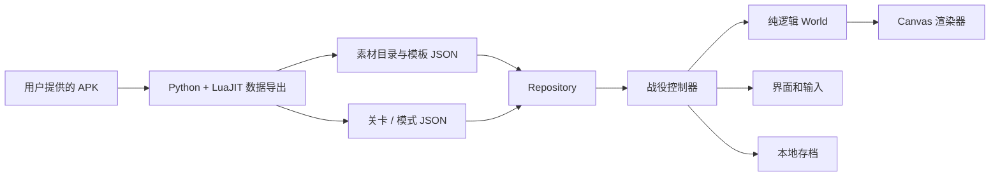

# 技术方案：数据驱动的塔防战役

当前范围是游戏开始界面、大地图，以及前三关的战役、英雄挑战、钢铁挑战，共 9 个组合。运行时只有静态 HTML、CSS、原生 ES Modules 和 Canvas 2D，没有游戏服务器、账号系统或运行时第三方依赖。这样同一份文件既可部署到静态站点，也可在本机通过 HTTP 服务器运行。

## 模块边界

MapHeroHud读取进度、原地图元数据和英雄点数预算，独立维护界面入场与提示淡入/缩退，坐标不依附可拖动地图。mapHeroHint是纯条件选择器，持久化发生在真实展示时；受限角色/未完成全局天赋不会产生假入口。训练后每帧从同一技能预算读取剩余点数，避免复制一套计费规则。

balloon.mjs共享地图与战斗的九片气泡、箭头和字体构建，调用者提供坐标参考宽度。地图淡入读取MapScene展示时间，战斗脉冲/缩退仍由Guidance负责。mapInitialized只标记首关地图记录已建立，不影响战役解锁、英雄经验或always教程。

MapUnlockSequence从本次进度与上次展示快照生成各关奖励、道路和新旗的绝对时间，不依靠多个并行setTimeout。MapScene共用展示时钟绘图并依事件游标只播放一次声音；地图资源就绪后才推进。mapSize/mapCenter封装原尺寸与边界，Campaign处理双轴拖动和resize，不改World或存档战斗数值。

SceneTransition独立处理加载门和串行场景交接，展示时钟与World分离。prepare只在关闭完成后执行，返回后才开门；事务代号贯穿Repository等待和Renderer提交，取消后的异步结果不能重置当前场景。等待期间World暂停，正常完成后才恢复输入/教程；失败走地图恢复分支。

鬣狗的临时脱离状态由World的updateHyena在守军寻敌后、路径移动前处理。cowardUntil限制重复拦截，结束时恢复速度；soldier/hero的近战候选排除该状态，远程候选保留。Renderer按状态选择walking/running原方向动作，不更改寻敌、速度或伤害。

敌人持续状态由World维护：咬噬者光环按模板周期/椭圆与vis筛选更新自身modifier，伤害倍率在命中时消费，持续时间与动画起点分别保存。Renderer只读取状态画原素材，刷新状态不会重启循环动作，也不消耗展示以外的随机数。



| 模块 | 职责与约束 |
| --- | --- |
| `web/domain.mjs` | 纯战斗模拟、规则校验、模式规则和进度转换。不访问 DOM、Canvas、网络或 localStorage。 |
| `web/repository.mjs` | 加载和缓存关卡、图片，提供三个存档位。存档失败不阻止继续游玩。 |
| `web/renderer.mjs` | 把世界状态映射到画面。使用原始精灵的裁剪、锚点、偏移和动画配置，不改变金币、生命或伤害。 |
| `web/campaign.mjs` | 页面状态、用户输入、选塔菜单、模式选择、音频与胜负处理。通过 World 的方法执行动作。 |
| `tools/extract_campaign.py` | 从 APK 导出素材、模板和九套规则；区分战役、英雄和钢铁各自的实体和预建塔。 |
| `tools/build_site.py` | 复制静态运行文件，产出带 SHA-256 清单的部署目录，避免源文件与线上包不一致。 |

## 状态与数据模型

屏幕状态为 `title → saves → map → loading → battle`。设置、关卡说明和暂停使用独立对话框状态；对话框打开时暂停战斗。胜负结算只在战斗状态变成 `won` 或 `lost` 后触发。进入新关卡创建新的 World，保留存档，不沿用上局敌人、技能冷却或计时器。

关卡标识是 `(stageId, mode)`，不是地图文件名。九个 JSON 各自包含金币、波次、敌人队列、路径、建造点、预建建筑和禁用规则。地图图片由三个模式共享。增加关卡时新增数据与素材，不复制一套战斗循环；增加模式规则时修改模式定义和数据转换，不在界面中绕过规则。

```text
World
  id / mode / difficulty / seed
  status / paused / time
  gold / lives / wave / totalWaves
  routes / slots / plants
  enemies / soldiers / hero / shots / effects
  pending / nextWaveReadyAt / nextWaveAt
  cooldowns / events
```

`build`、`upgrade`、`sell`、`startWave`、`cast`、`setRally` 和 `moveHero` 都验证输入与当前规则。按钮禁用只负责告知用户；真实的金币不足、挑战禁塔、技能冷却检查仍在领域层执行，界面或测试无法靠调用相同动作绕过。

## 时间、路径和战斗

模拟采用固定步长 `1/60` 秒，画面使用 requestAnimationFrame；倍速只增加模拟步数。随机数由可注入的 seed 生成。Node 测试不需要浏览器就能复现战斗。

原始配置的时间单位是 30 FPS 帧数。每一条出怪队列累加自身间隔，缺失的可选 `interval` 按零处理。本组所有出怪结束后，才开始下一组的等待时间；玩家可在下一组准备好后提前召唤。不能从本波开始时就计时，否则后续关卡会出现不符合原版的大量叠波。

每条路线保存节点、累计距离和终点距离。单位沿距离插值移动，不按横坐标判断漏怪，因此向左、向上和向下的出口共用同一套逻辑。瀑布小径的 `3 → 4` 连接显式转移路线，不把飞行单位在中间路径的末端当作漏怪。

伤害分为物理、魔法、范围爆炸和无视护甲。使用原始敌人模板中的护甲与魔抗。飞行标记阻止地面兵营拦截和火炮攻击；二级以上兵营精灵的远程攻击可以命中飞行单位。塔的价格、射程、冷却、投射物伤害与士兵属性均从模板读取。

## 模式与存档

| 关卡 | 战役：金币 / 波数 | 英雄：金币 / 波数 | 钢铁：金币 / 波数 |
| --- | --- | --- | --- |
| 灰鸦港口 | 320 / 6 | 320 / 6 | 460 / 1 |
| 高桥 | 350 / 8 | 480 / 6 | 225 / 1 |
| 瀑布小径 | 400 / 10 | 440 / 6 | 750 / 1 |

战役有 20 生命，挑战只有 1 生命。模式 0 的实体共享，1/2/3 分别对应战役/英雄/钢铁；高桥和瀑布小径的预建兵营必须按模式筛选，不能让其他模式的建造点重叠出现。

战役胜利解锁下一关，获得三星后解锁本关两项挑战。最高星级只增不减；挑战徽章按关卡与模式分别记录。三个存档位互相隔离，保存版本号便于后续迁移。当前存档是本机浏览器存档，跨设备同步需要后续增加独立存储适配器。

## 验证与扩展

领域回归测试覆盖全部九个模式的真实配置、正常预算下的完整通关、失败、禁用塔、升级与出售、冷却、原始缺省字段、护甲、飞行目标和瀑布连接。浏览器回归通过实际按钮进入游戏、选择存档和模式、建塔升级出售、保存后刷新、完成九个模式，并检查手机横屏、HTTP 错误和 JavaScript 异常。

`tests/strategies.mjs` 是回归测试的合法操作脚本，不向产品提供自动通关，不增加金币、不改血量，也不修改原始波次。完整通关回归在休闲难度执行；这证明组合可完成，不代表已经平衡了全部难度。

当前仍是浏览器复现：菜单排版、教学弹窗、音效时序、部分近战移动和英雄技能未做逐帧像素验收；全局天赋树、成就、跨设备存档和后续关卡不在本次实现范围。后续可把技能与关卡机关移到独立效果系统；在已有测试保障下接入新效果，而不把关卡特例继续加进界面控制器。

## 动作时间与表现层契约

每个士兵独立记录 `actionAt`、`walkAt`、`pendingHit`、`departAt` 与死亡计时。战斗层在原始 `hit_time` / `shoot_time` 执行伤害或生成飞弹，渲染层只根据同一动作起点取 30 fps 帧，不能通过播放动画产生伤害。兵营门的五帧打开、0.5 秒保持、四帧关闭，与士兵离营共享 `doorAt`。建造保留原始 `build_duration` 与施工模板。

多人物塔不能共用整个实体的动画状态。`Renderer.entity` 支持每层 `spriteStates`：二、三级弓箭塔的两名射手轮流射击；静态塔身不翻转；投石手的装填层仅在装填阶段显示。动画解析支持原始的 `from/to`、离散 `ranges` 与显式 `frames` 三种格式，单次动作钳制到最后一帧。

验收分两部分：领域测试核对出兵与攻击发生的时间、补员位置、升级保留状态；浏览器生成可查看的动作片段并验证缺失帧。通关通过不能替代画面对照。剩余差异记在 [FIDELITY.md](FIDELITY.md)。

## 原版界面布局的边界

`tools/read_ui.lua` 只提供模板需要的设计期上下文（向量、角度、翻译键），读取数据表；`tools/extract_ui.py` 从原图集裁剪并恢复透明边距，输出 `assets/ui/layouts.json` 和原版精灵。`Repository` 一并加载它们。

`web/ui.mjs` 将原始位置、锚点和尺寸换成容器百分比，支持普通/按下状态与对称九宫格。Campaign 将真实存档、模式锁定和战斗结果绑定到这些控件。界面适配不会改变游戏状态；领域层也不依赖参考屏幕的尺寸。

布局表来自 693×320 的原始手机界面坐标。宿主视口适配、中文字体回退、转场和未实现的原版控件必须独立列为差异，不能因复用了原素材就宣称全界面像素一致。

## 技能事件时间线

`web/spells.mjs` 的 `SpellTimeline` 只读取世界模拟时间：控制器事件按 `(at, sequence)` 排序，雷电在每个事件发生时重新选敌，箭雨独立记录每支箭的出发位置、目标节点、速度和抵达时间。`World` 在固定步长中推进它，命中会产生真实伤害、减速与渲染事件；Renderer 只绘制同一组飞行对象和落地事件。没有浏览器定时器，也没有与伤害脱离的装饰性假箭雨。

技能等级与英雄角色等级分别建模。未训练时艾莉丹箭雨采用原始零级值；训练等级独立保存，读取角色等级不能自动强化技能。`history` 保留最近 512 次实际命中，用于定位时序问题，不进入存档。通关策略只使用正常金币、技能冷却与操作，独立于战斗实现。

## 方向与操作动画

`Renderer.enemyDirection` 根据路径切向量选择原始侧面/上/下帧，侧面默认朝右；WeakMap 保存转向保持状态，避免将表示状态写进 World。方向回归直接截取 Renderer 实际选择的精灵与镜像参数，覆盖九模式路径，补上通关测试无法发现的视觉错误。

建塔菜单的 120ms 缩放/透明度由同一 Web Animation 驱动，取消旧动画后再重开，收起完成后才清空节点；收起期间使用 inert 阻止过期操作。界面时钟不影响战斗时钟。

## 英雄与交战状态

英雄独立保存 `stance`、`action/actionAt`、`walkAt`、`flip`、`pendingHit` 和 `combatTarget`。移动、弓剑切换、起手、实际伤害和死亡复活都使用 World 模拟时间；Renderer 读取这些状态选择原帧。移动命令会取消尚未执行的出箭/挥剑事件，不删除已经飞出的箭。交战期间的拦截与攻击冷却独立于动作播放，避免武器切换时敌人穿过英雄。

敌人的 `actionFlip` 来自真实守军位置，独立于沿路行走方向；`enemyMelee` 每个模拟时刻最多推进一次攻击，英雄与兵营不能重复扣减同一敌人的冷却。经验与训练通过独立的 progression 模块建模；全局天赋尚未实现。

## 英雄成长与存档迁移

`tools/read_progression.lua` 导出原始成长配置，生成 `web/hero-data.mjs`。纯函数模块 `web/progression.mjs` 负责累计经验阈值、难度/关卡等级倍率、技能点总预算、扣点/重置与旧存档迁移。角色等级、训练等级和全局天赋属于不同概念，不能互相推导。

World 为英雄伤害保留 XP 归属，命中后进入 `heroXpQueued`；在动作边界应用原始倍率和舍入，达到阈值后更新角色属性并产生升级/经验事件。Campaign 消费事件保存已结算经验，下一局以 `heroXp` 和 `heroSkills` 创建 World。正常通关只更新关卡进度，不直接增加角色等级。

存档继续使用 version 2 槽位，并新增 `heroProgressVersion: 1`、`heroXp`、`heroSkills`。旧英雄等级转换到对应经验下限以保留用户已有进度；缺少的真实经验历史无法重建。Repository 在读取边界规范化技能等级和总预算，训练函数再校验预算，界面禁用不是唯一限制。

箭猪连续目标状态只属于本局英雄，按目标 ID 记录层数；每次起手把额外伤害快照到 pendingHit，再传入实际飞弹。已飞出的箭不读取后续目标状态，避免换目标或下一次连射修改在途伤害。

英雄连射控制器记录当前阶段、剩余箭数、当前目标和预测分配数量；原动作时间触发 pendingHit，每支箭独立持有伤害。闪避检测属于敌人的 pendingMelee，在其 dodgeAt 做一次随机检查，成功只抑制该次伤害；英雄通过独立 counterPending 排入反击。表现层继续只读取真实动作和飞弹，不产生伤害。

敌人投掷起手使用 pendingRanged，远程与近战分别计时；到达出手时刻生成固定弹道飞弹。World 对落点检查目标有效性后应用初始伤害和独立燃烧状态，持续伤害按 next/until 模拟时间调度。Renderer 使用同一个飞弹位置和燃烧状态画原素材，不能用装饰性投掷替代实际伤害。

`MapTimeline` 使用独立展示时钟和随机序列，按原布局计算装饰帧、路径弧长位置和道路点展开。`MapScene` 负责预加载原图集并将底/顶层画到两个 Canvas；Campaign 记录每个存档位已展示的解锁等级，返回地图时只播放新增道路。统一 640×510 坐标，不依赖战斗路径，也不通过 CSS 动画推导游戏进度。

`MapShip` 将原协程转为有限阶段：港外等待、进港、停泊、转向、朝外等待、离港。每个阶段独立持有持续时间；地图展示时钟跨越边界时保留剩余时间。船身和两层水纹输出统一的绘制姿态，复用 MapScene 原图集与原锚点。

`map-flags.mjs` 将存档的战役/英雄/钢铁完成状态映射到独立绘制层。道路完成和落旗结束决定按钮能否接收输入，Canvas 动作由同一个地图时钟驱动。资源存在性优先于布局声明；本包新版旗帜帧缺失时使用明确记录的兼容图集，不能以虚构帧名掩盖缺失。

字体通过 `assets/fonts/catalog.json` 与原文件版本化。Repository 加载角色映射和原界面文案；NativeUI.fontStyle 将原 font_name/font_size 与 locale 倍率转换到同一参考容器，HUD 保留其自身角色。提取与静态构建显式包含字体，避免运行设备的系统字体改变字形和排版。


波次入口由 Campaign 根据下一波路径生成按钮，复用 Renderer 原图集；多个入口共享 sendWave 命令和 World.startWave 的校验/奖励。按钮展示状态不参与模拟时间。Renderer 不再重复绘制无法交互的旗帜。

`wave-flags.mjs` 独立负责脉冲/扇面与 Canvas 分层，incomingReport 仅汇总对应入口的源波次数据。Campaign 负责单选和二次点击命令；World 保留唯一召唤奖励与时间推进权。

IncomingTooltip 独立管理原文本角色、测量和相对旗帜的定位/显隐；Campaign.deselectWaveFlags 统一退出选中状态，避免切换输入模式遗留浮层。动画重入使用版本号，旧 fade 完成回调不能隐藏新浮层。

waveEntrances 读取原关卡作者入口，findWaveFlagPosition 以显式可见边界/间距求展示坐标。Campaign 提供 Renderer.world 逆变换得到的边界；入口展示不依赖寻路采样，世界模拟与屏幕缩放保持分离。

BattlePortraits 将原英雄肖像和技能图层画到按钮Canvas，读取已结算XP、血量/复活时间、冷却与输入选择。按钮可访问状态仍由Campaign控制，渲染器不写World；战斗核心与展示冷却相分离。

PowerTimeline 按World隔离展示状态转换，输出门/光效帧和一次就绪通知；BattlePortraits 绘制帧，Campaign 接收通知播放原声音。展示时间线不更改技能可用时刻或世界冷却。

Tutorial markup从原布局递归展开图片/文本/按钮，源坐标在各页独立参考容器中换算。Campaign管理页间导航、暂停恢复与seenNotifications存档；领域World不参与教程UI。浏览器回归通过合法点击教程按钮进入战斗，不设置测试专用跳过开关。

通知布局连同原ctx元数据由extract_ui导出，字体提取同步收集所用中文。Campaign将首关波次事件映射到队列，展示与seen记录/always策略分离，模态关闭后串行继续。测试策略提供可选afterStep观察器，浏览器在真实事件边界触发通知按钮的正常处理，不修改World数据以绕开暂停。

Guidance 持有独立展示时钟与原气泡描述，按hide_cond接受语义事件并接续balloon_on_hide，不驱动世界。世界坐标和UI坐标通过guidancePosition分别换算，重开时清理节点和时间；模态期间遮蔽指引，结束时清理。

EnemyNotifications消费World的enemy_spawn语义事件，按存档抑制重复并维护独立展示队列。已读在入队保存，与玩家是否打开面板分离；点击接入既有模态队列/暂停机制。图标缩退后压缩队列，展示时间不参与战斗随机或伤害。

NotificationMotion独立管理浏览器展示动画，World在正常模态关闭时立即恢复；退出副本inert且去掉ID，动画结束清理。初始化/翻页取消上一入场定时器，声音不会从旧页面延迟触发；场景切换清理所有副本。原通知规则/存档与战斗数值不受动画时钟影响。

HudMotion从导出的battleHud父容器尺寸计算各组偏移，以独立展示时钟插值translate。重入复制当前坐标作为新起点；通知模态负责目标状态，World暂停/恢复仍由Campaign决定。图标、肖像和技能原图层不需要知道HUD移动状态。

WaveFlag退出将已绘制Canvas复制到不可交互副本，保留稳定输入按钮给下一波。WaveReward只消费World bonus事件绘制原金币和数字，不增减金币或冷却；展示时间与世界模拟分离，场景切换清理。

提前波奖励在World.startWave内以原取整顺序结算金币与冷却，分别发bonus/cooldown_bonus事件。后者使用power字段，不能覆盖事件type。WaveReward仅绘制这次实际结算的名义秒数，技能状态继续由World维护；原规则数据独立生成wave-rules，避免与英雄训练配置混用。

ResultMotion以独立展示时钟读取已结束World的模式/星数，按原模板选择徽章及星帧，串行控制按钮显隐和启用、原星声音。结果保存仍在Campaign完成，展示时间线不改变通关阈值/奖励，场景切换销毁控制器。

ellipseGlyphs将字符宽度与原椭圆参数转为独立位置/旋转/锚点，drawEllipseText只处理字体测量与Canvas变换。失败页复用layoutMarkup的原图层与字体规则，交互ID继续映射到Campaign重试/退出命令。

VictoryParticles使用独立PRNG和固定小步积分，ResultMotion只提供展示时钟与生命周期。全屏粒子Canvas与缩放徽章分层，切场景由ResultMotion.reset删除；宝石区域展示只读当前结果，不生成经济奖励。

## 全局星星升级

upgrade-data.mjs由原upgrades数据生成；upgrades.mjs负责星预算、合法购买/重置及每局模板补丁。Repository在存档边界规范化选择，Campaign将选择传给World；World在建立守军前按挑战上限生成独立模板，不修改Repository共享资源。upgrades-ui.mjs只呈现原节点和调用同一购买规则，未实现节点保持禁用。地图升级提示只在真实入口可用后启用，与英雄成长提示和战斗always通知分开。

第二层全局升级由previousUpgrade和canBuyUpgrade统一校验同系前置；normalizeUpgrades按已支持层级顺序恢复合法连续链。patchUpgradeTemplates按本局挑战上限过滤效果，与永久存档选择分离；兵营交互直接读取补丁后模板，不另存一份固定范围。默认无天赋仍复用原资源，避免跨局模板污染。

UpgradeTimeline维护购买按钮的当前线性插值和单次勾选帧；UpgradeMotion在重绘详情时保留展示状态，切场景/退出统一reset。UpgradeBurst使用独立展示PRNG与固定积分，不访问World。ui模块仍使用同一领域购买规则，购买成功后才创建粒子并选下一项；异步图集加载只影响绘制，不影响扣星。手机版面板本身按源立即显隐。

雷电一级沿用模板补丁边界：星星购买记录只决定本局power_thunder_control.count，SpellTimeline读取同一模板排入真实事件。基础3击、选购6击与挑战上限分开测试。援军一级同样通过本局三个re_current别名替换应用，原零级和可选一级共用同一冷却/寿命与渲染时间线。

援军通过re_current_1/2/3别名选择本局已应用天赋的模板；cast负责原随机与生成偏移，World保存spawnAt/departAt/expires/fadeOutAt，updateSoldiers负责等待、撤销攻击及离场移动。Renderer读取同一时间点的alpha和walking，不独立删除单位或产生伤害。reinforcement一级与其他全局升级共用独立预算/存档/cap，不依附英雄训练。


MenuMotion仅处理screen_slots菜单内部logo/按钮/存档面板的原坐标时间线，与SceneTransition战场加载门分开。Campaign在替换DOM前捕获当前显示位置，副本只参与绘制，原按钮身份与存档操作保留；transition统一cancel，版本检查阻止旧完成回调改写新状态。动画不会访问或推进World。


存档到地图、地图到screen_slots根菜单由Campaign.selectSave/returnToMenu接受一次路由；原数据确认需要loading后复用SceneTransition。waitScreenReady等待实际背景/DOM图片/地图资源和首画，事务current检查贯穿异步边界。SceneTransition暂存宿主inert状态并在取消或当前事务完成时恢复，MenuMotion暂停/恢复只作用于同版本菜单；直接渲染函数仍可供受控测试使用。

SaveSlots只负责原三行模板与页签展示。Repository.has区分真实槽记录与load提供的空进度，slotSummary使用同一总星预算并独立统计挑战。删除由控制器清理对应槽及地图展示缓存，场景transition取消所有页签动画；不会修改World或其他槽。

hero-room.mjs将原模板key与原字符串绑定为下一等级技能预览，训练和重置仍调用progression同一预算函数；只读经验计算属性/经验条。训练粒子复用UpgradeBurst的展示随机与时间，Campaign在tick推进并在dialog/close/transition清理，不改World。

英雄殿堂帮助仅由真实遮罩点击保存seenMapHints.hero_room_help，下层按钮暂存并恢复inert；关闭不改变已读。HeroFeedback独立读取UI时间画原两处白闪，Campaign统一在dialog/close/transition清理。createBalloon新增显式资源prefix参数，既有地图和战斗气泡默认资源保持不变。

encyclopedia.mjs只读原模板、声明目录和已保存spawn通知状态，enemyUnlocked/ enemyBookStats为纯查询；不创建World单位或修改发现状态。原书页坐标/锚点与文字角色在独立592×320容器绘制，翻页保留详情并重建缩略图，关闭后没有异步提交回调。read_encyclopedia.lua只读取声明配置，完整提取包括独立缩略图图集。

百科提示页只读声明配置与原文，页码为对话框局部状态，重开回1；与enemy发现、存档和World无耦合。共用markup新增原横向三片背景与显式line_height的字体测高换算，不更改NativeUI全局变换。

百科塔书页的towerBookStats仅读取Repository基础模板，不读取World克隆后的升级模板。towerUnlocked读取原布局always_shown与存档发现键；战役二/三关首波原通知通过统一串行通知队列展示，并在展示时保存meta.seen附属塔键。浏览书页本身不解锁、不扣费、不改战斗。

TowerMenu独立维护当前菜单选择和原提示框，菜单数据/几何来自原声明；动作只调用World公开接口，双击确认不直接修改金币/模板。提示读取本局World模板以反映已购买天赋，百科仍读取Repository基础模板。菜单动画/提示测量不消耗World随机数；固定游戏viewport的DOM scroll与原地图pan分开。

出售唯一计算入口towerRefund仅读取实际支出、模板因子和已发波数，UI文案与World到账共享；准备时间/塔的标价不替代这些状态。构建自动复制全部顶层运行时mjs并检查相对import存在，部署验证须覆盖build目录，避免源码目录通过却漏发模块。


Infobar只查询选中塔的本局模板，按原STATS_TYPE构建肖像/文本/两段原布局；展示时钟与World随机和时间分离。infobarViewport读取原phone参考尺寸与aspect常量，Infobar以game内尺寸定位，不能把静态battle-ui的零高度当viewport。UI实体选择、模态与场景门控共同决定显隐；交易只由既有World接口修改领域状态，百科基础数据与战斗天赋数据仍分开。


TowerMenu复用infobarViewport的phone参考窗口，towerUiPoint把Renderer画布坐标转换到GUI逻辑坐标，圆环和tooltip再统一映射回实际game内像素；towerTooltipRect仅读source右侧分支与中心ceil规则。World位置/交易状态不变，不用屏幕CSS夹紧替代后续原相机fit_screen实现。


BattleCamera只维护展示姿态和原fit目标的.2秒插值；Renderer内部绘制使用基础投影加统一Canvas变换，外部投影和逆投影使用相机。Campaign逐帧同步世界DOM控件，TowerMenu从相同投影定位原GUI。异步loadLevel在current校验后提交资源并重置相机，避免旧加载重置新镜头；领域World不感知相机。


CameraGesture封装原输入状态、缩放比、阻尼与六样本惯性；CameraInput适配浏览器指针/滚轮和场景门控并负责监听清理，鼠标移动按展示帧消费，触摸按事件消费。BattleCamera插值可用源时长和曲线，默认仍是塔菜单.2秒；World不处理相机输入，正常点击交易继续经过原公开接口。


world-rules.mjs由原声明常量和director纹理比例派生，世界ref尺寸、GUI ref尺寸、图集像素尺寸分开。worldViewport提供原game_scale和camera世界边界；Renderer在世界Canvas分支应用纹理ref_scale，UI Canvas不继承它。背景和普通精灵共用原世界单位链，初始相机与逆点击不再依赖旧7/6常数。


BattleTop局部读取原顶部布局，保留稳定HUD/暂停/英雄节点并按GUI参考窗定位；HudMotion从节点guiScale换算对应组的原位移，未迁移能力栏仍保留原路径。通知队列及TB_NOTI共用本批GUI坐标，领域统计与按键处理仍由Campaign/World原接口负责，不更改NativeUI全局变换。

BattleTop同时维护原powers父子GUI几何；battlePowerGeometry独立选择源hud_scale，仅用于技能组图面/点击区域，motionScale保留父节点位移的GUI尺度。Guidance仅对原GUI技能提示补native坐标，不影响World投影或领域技能时间线。

Infobar数据适配按塔与hero targeting分支选择，heroInfobarData只读取实时World单位与模板。原with_health部件复用同一布局渲染器，health_bar局部左锚scaleX，不改NativeUI全局变换；选择/取消仍由Campaign现有状态负责。

enemy-selection.mjs纯查询World活敌与源ui矩形，不负责修改敌人；Campaign单独持有selectedEnemy展示引用，Infobar清理失效引用并读取实时数据。塔selected与技能targeting仍保持原接口，避免把敌选择写入塔slot索引。

SelectionMarkers持有每次选择的展示目标快照，死/移除后只过滤不自动补入复活士兵；Renderer使用原marker元数据与世界投影绘制，Campaign只传选择状态。声明数据由extract_markers独立生成且被全量提取调用，展示不向World插实体或消耗随机数。
